# decision-supporter-mvp

충파모 공식 단일 모노레포 · 가상 휴지 제조기업 생산계획 지원 MVP.

**최신 현황:** [PROJECT_PROGRESS](docs/PROJECT_PROGRESS.md) · **누적 개발 이력:** [DEVELOPMENT_CHANGELOG](docs/DEVELOPMENT_CHANGELOG.md) · **Codex 상시 작업 규칙:** [AGENTS](AGENTS.md). 새 작업은 이 문서들을 먼저 읽고 종료 시 갱신합니다. 아래 날짜별 설명과 테스트 수치는 각 작업 당시의 기록이며 최신 상태는 PROJECT_PROGRESS를 따릅니다. 현재 보조 PC에서는 Docker·PostgreSQL 관련 작업을 일절 수행하지 않습니다.

## 한눈에 보기: 각 파트가 어떻게 동작하나 (2026-11-25 화면 개편 기준)

2026-11-25에 화면(frontend)을 다섯 화면 구성으로 새로 만들었습니다. 이 절은 **화면이 각 담당자의 코드를 어떻게 부르고, 받은 값을 어떻게 보여 주는지**를 그림으로 정리한 것입니다. 서버·엔진·분류기의 계산 방식은 바뀌지 않았고, 바뀐 것은 "화면이 그것들을 쓰는 방식"입니다.

> 그림의 색: 파랑 = 서버(김대영), 초록 = 계획 엔진(이희원), 주황 = 파일 분류기(이훤), 회색 = 화면(정마나미). 이 절의 내용은 2026-11-25에 로컬에서 CHUNGPAMO-2027 자료로 끝까지 실행해 확인한 것입니다. 브라우저 자동 시험(`tests/e2e/browser`)은 예전 화면 기준이라 다시 맞춰야 합니다.

### 1. 전체 구조

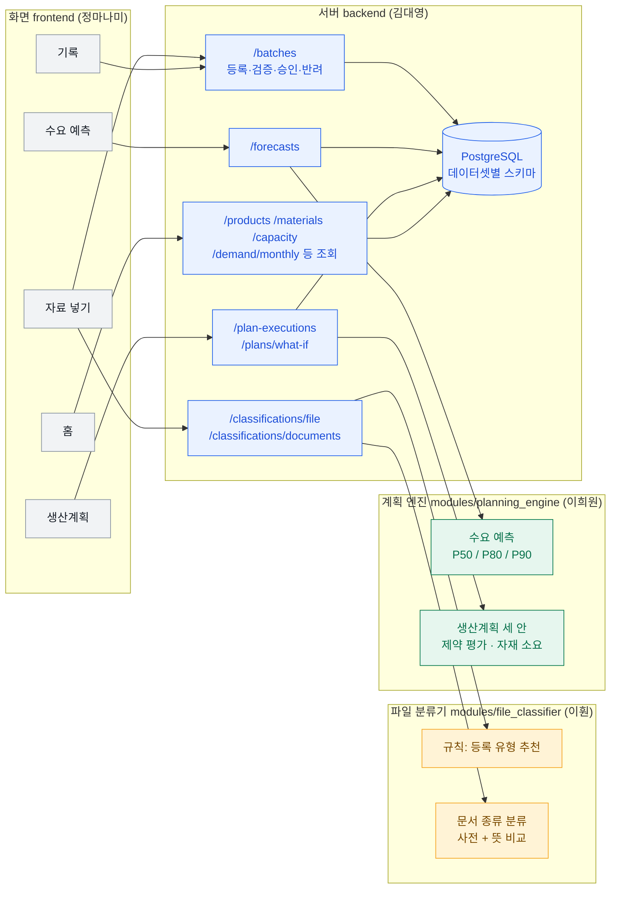

### 2. 사용자가 밟는 순서

자료가 승인돼야 예측을 돌릴 수 있고, 예측이 있어야 계획을 세울 수 있습니다. 화면 맨 위의 진행 표시(자료 → 예측 → 계획)가 이 순서를 그대로 보여 줍니다.

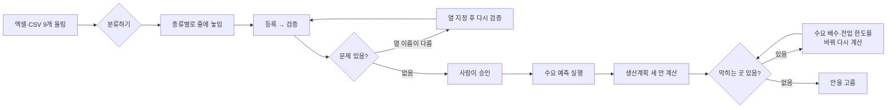

### 3. 화면이 부르는 서버 주소

| 화면 | 화면 주소 | 부르는 서버 주소 | 무엇을 하나 |
|---|---|---|---|
| 틀 (모든 화면) | | `GET /health`, `GET /datasets` | 15초마다 서버·DB 상태 확인, 데이터셋 목록 |
| 홈 | `#home` | `GET /batches`, `GET /forecasts`, `GET /forecasts/{id}`, `GET /plan-executions`, `GET /plan-executions/{id}`, `GET /demand/monthly`, `GET /products`·`/materials`·`/capacity` | 현황을 한 번에 읽어 "가장 빠듯한 곳"을 계산 |
| 자료 넣기 | `#ingest` | `POST /classifications/file`, `POST /classifications/documents`, `POST /batches`, `GET /batches/{id}`, `POST /batches/{id}/revalidate`·`/approve`·`/reject` | 분류, 등록, 열 지정, 승인, 반려 |
| 수요 예측 | `#forecast` | `POST /forecasts`, `GET /forecasts`, `GET /forecasts/{id}`, `GET /demand/monthly` | 예측 실행과 이력, 실제 수요와 겹쳐 그리기 |
| 생산계획 | `#plan` | `POST /plan-executions`, `GET /plan-executions`, `GET /plan-executions/{id}`, `POST /plans/what-if`, `GET /capacity` | 계획 계산·저장, 조건 바꿔 다시 계산, 잔업 한도 표시 |
| 기록 | `#history` | (홈과 같은 현황), `POST /batches/{id}/reject` | 이력 보기, 잘못 올린 자료 반려 |

데이터셋은 상단 선택 상자에서 고르고, 데이터셋 자료를 읽는 모든 요청에 `?dataset_id=...`가 붙습니다.

### 4. 화면별 동작

#### 4-1. 홈: 가장 빠듯한 곳을 첫 문장으로

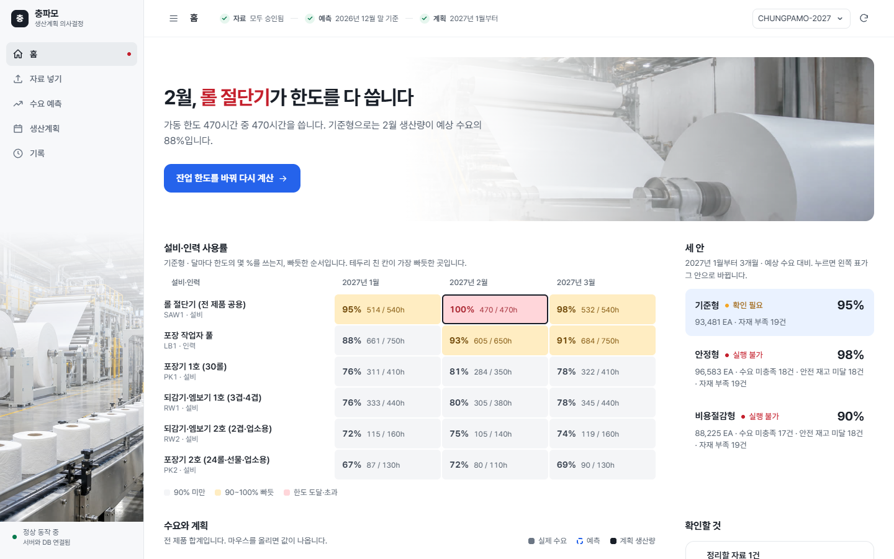

홈의 첫 문장("2월, 롤 절단기가 한도를 다 씁니다")은 고정 문구가 아니라, 가장 최근에 저장된 계획에서 계산합니다.

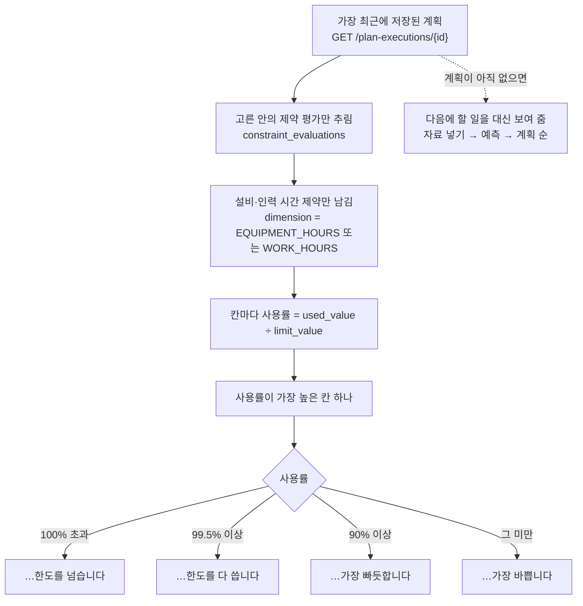

- 오른쪽 "세 안" 목록에서 안을 누르면 왼쪽 표와 그래프가 그 안으로 바뀝니다.
- 표의 칸이나 큰 버튼을 누르면, 고른 예측·시작 달·안·칸을 그대로 들고 생산계획 화면으로 갑니다.

#### 4-2. 자료 넣기: 올리기 → 분류하기 → 등록 → 승인

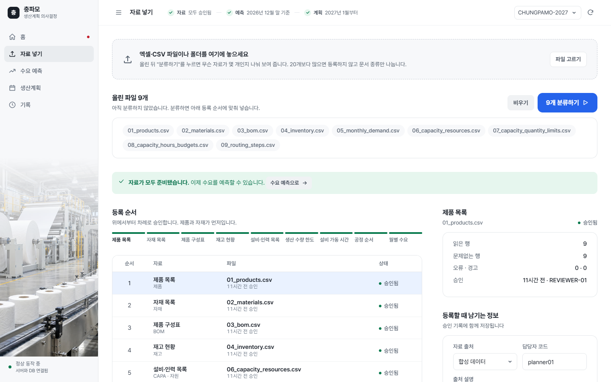

파일을 올리면 목록에만 쌓이고, **"분류하기"를 눌러야** 분류가 시작됩니다.

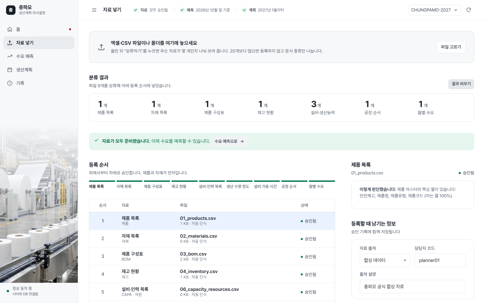

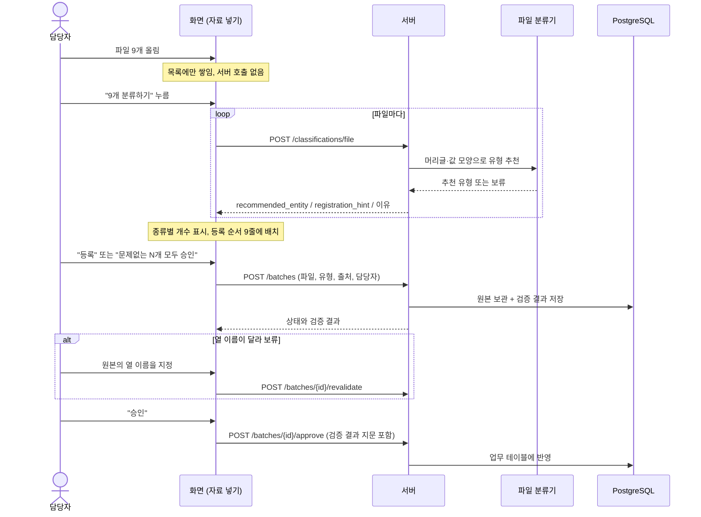

분류 결과를 등록 줄로 옮기는 규칙입니다.

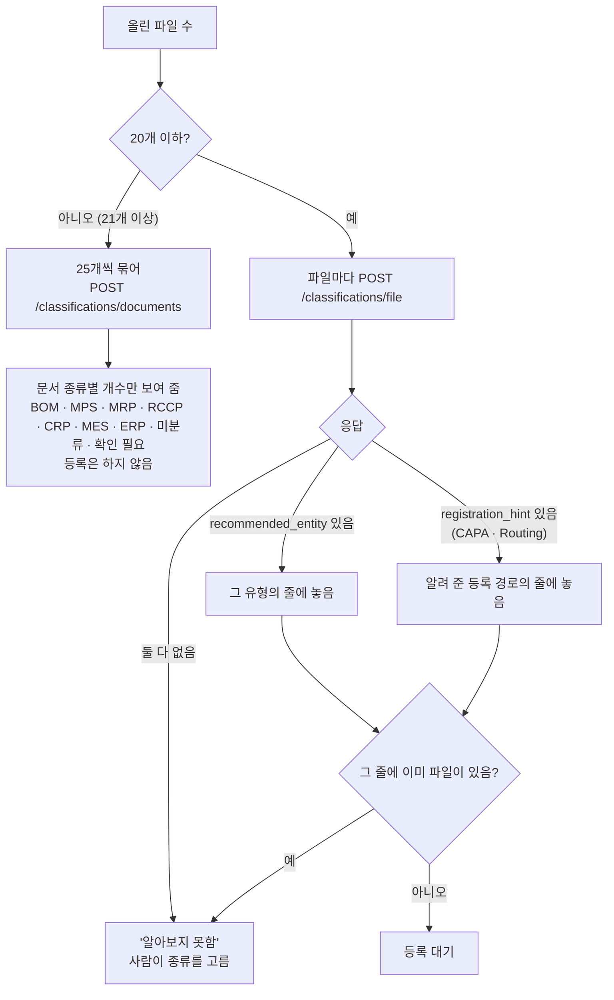

등록 순서는 9줄입니다. 제품과 자재가 먼저 승인돼야 뒤의 자료를 검증할 수 있습니다.

| 순서 | 자료 | 서버 유형 (entity) | 예시 파일 |
|---|---|---|---|
| 1 | 제품 목록 | `product` | `01_products.csv` |
| 2 | 자재 목록 | `material` | `02_materials.csv` |
| 3 | 제품 구성표 | `bom` | `03_bom.csv` |
| 4 | 재고 현황 | `inventory` | `04_inventory.csv` |
| 5 | 설비·인력 목록 | `capacity` (resources) | `06_capacity_resources.csv` |
| 6 | 생산 수량 한도 | `capacity` (quantity_limits) | `07_capacity_quantity_limits.csv` |
| 7 | 설비 가동 시간 | `capacity` (hours_budgets) | `08_capacity_hours_budgets.csv` |
| 8 | 공정 순서 | `routing` | `09_routing_steps.csv` |
| 9 | 월별 수요 | `monthly_demand` | `05_monthly_demand.csv` |

배치(올린 파일 하나)의 상태는 이렇게 바뀝니다.

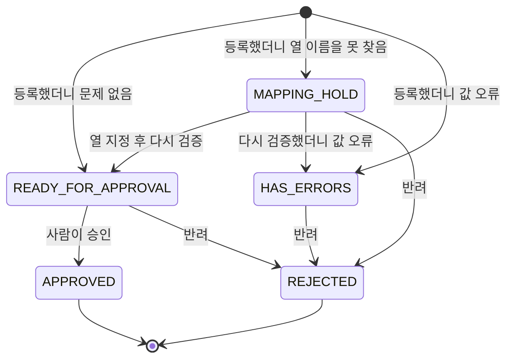

#### 4-3. 수요 예측

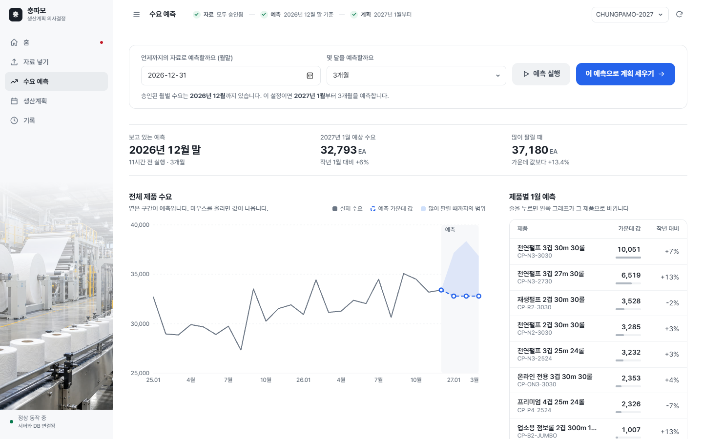

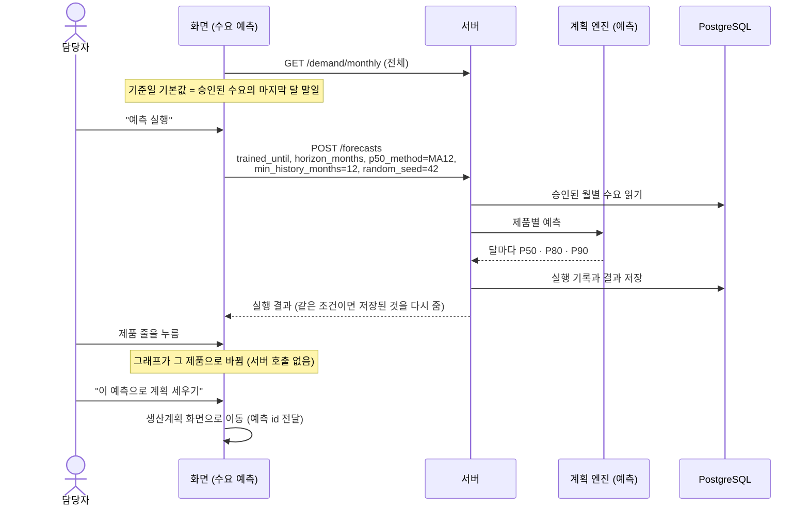

- 그래프의 회색 선은 실제 수요, 파란 점선은 예측 가운데 값(P50), 옅은 면은 많이 팔릴 때(P90)까지의 범위입니다.
- 제품 표의 "작년 대비"는 예측한 첫 달의 P50을 작년 같은 달의 실제 수요와 견준 값입니다.
- 예측 범위를 확률처럼 표시하지 않습니다.

#### 4-4. 생산계획과 "조건 바꿔 다시 계산"

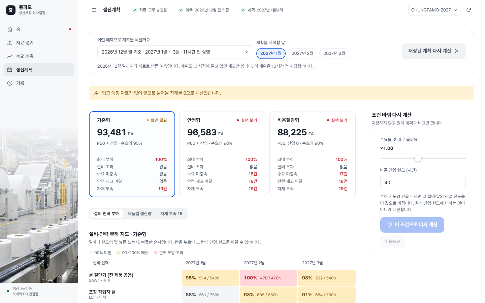

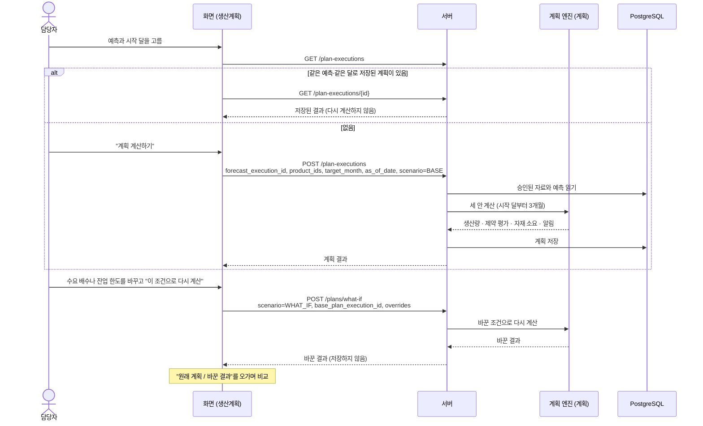

화면이 엔진 결과에서 읽는 값입니다.

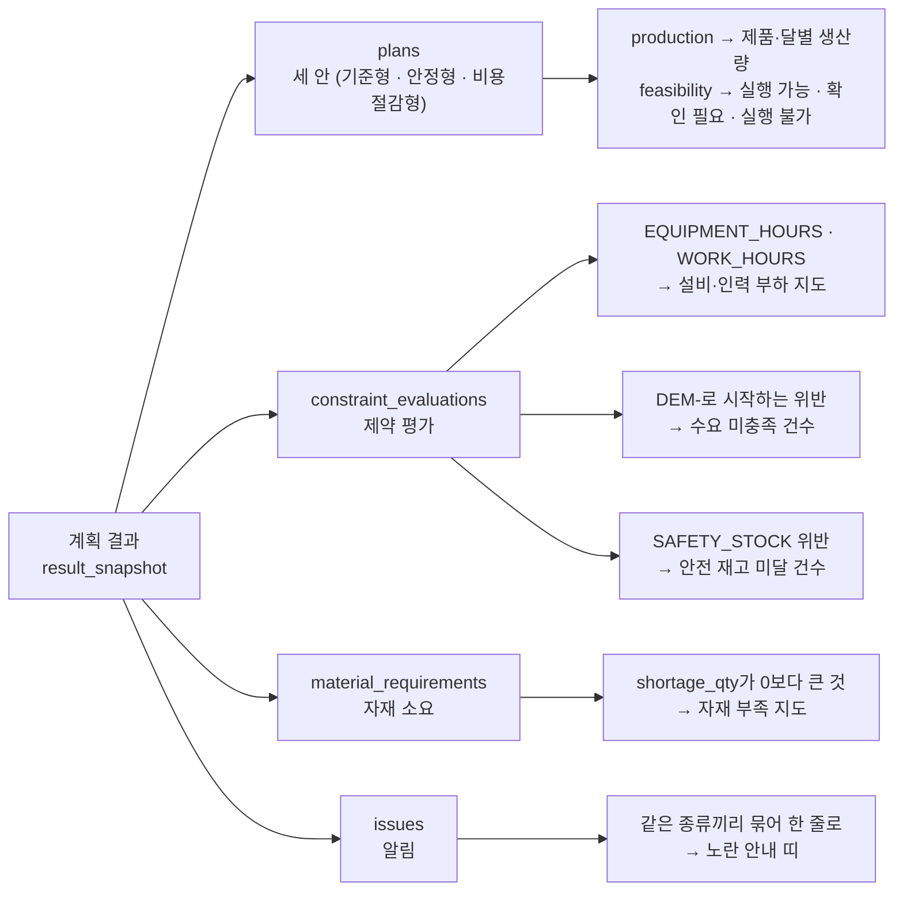

부하 지도의 색 기준은 화면 전체에서 같습니다.

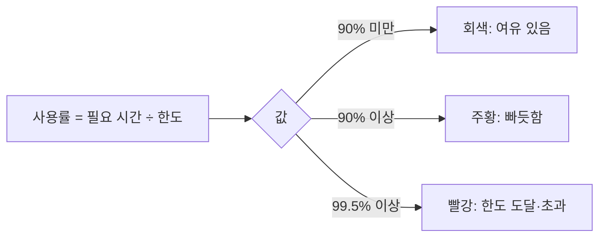

**잔업 한도는 "더하는 시간"이 아니라 "그 값으로 바꾸는 것"입니다.** 화면은 `GET /capacity`의 시간 예산(`regular_hours`, `overtime_hours_limit`)을 읽어 지금 값을 함께 보여 줍니다.

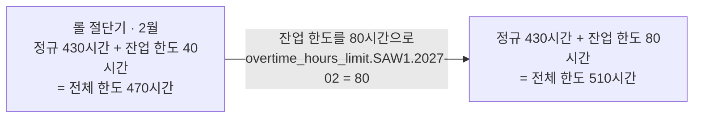

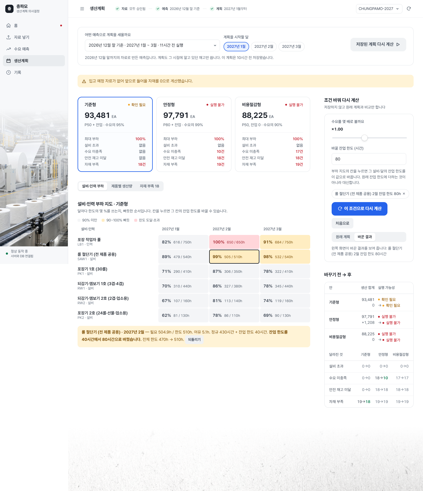

화면이 보내는 조건(`overrides`)은 두 가지입니다.

| 키 | 뜻 | 예 |
|---|---|---|
| `demand_multiplier` | 예상 수요를 몇 배로 볼지 | `1.10` |
| `overtime_hours_limit.<설비>.<달>` | 그 설비·달의 잔업 한도를 이 값으로 | `overtime_hours_limit.SAW1.2027-02` = `80` |

서버가 받는 `receipt_qty.<발주>`(입고 수량)는 화면에 아직 없습니다.

#### 4-5. 기록

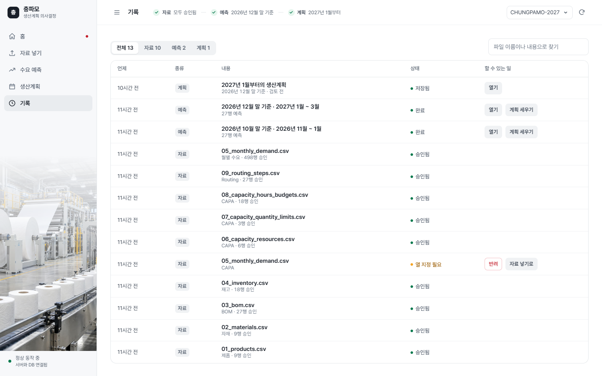

올린 자료, 예측, 계획을 한 표에 시간순으로 모읍니다. 승인되지 않은 자료는 여기서 반려할 수 있습니다.

### 5. 화면 안에서의 계산과 움직임

화면은 서버 값을 그대로 보여 주고, 보기 좋게 묶고 견주는 계산만 합니다.

| 화면이 계산하는 것 | 어떻게 |
|---|---|
| 수요 대비 % | 안의 생산량 합 ÷ 같은 달들의 예측 P50 합 |
| 가장 빠듯한 칸 | 설비·인력 시간 제약 중 사용률이 가장 높은 칸 |
| 자재 부족 비율 | `shortage_qty` ÷ `required_qty` |
| 작년 대비 % | 예측 P50 ÷ 작년 같은 달 실제 수요 |
| 알림 묶기 | 같은 종류의 알림을 한 줄로, 건수와 대상 이름을 붙임 |

값이 바뀔 때 그래프는 제자리에서 모양만 바뀝니다.

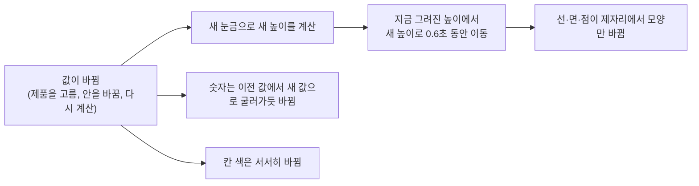

윈도우의 "애니메이션 효과 줄이기"가 켜져 있으면 움직임 없이 바로 바뀝니다.

### 6. 담당자별: 내 부분이 어떻게 쓰이고, 무엇이 달라졌나

#### 서버 (김대영)

- **계산과 저장은 그대로입니다.** 화면이 부르는 주소는 3절의 표가 전부입니다.
- **새 화면이 부르지 않는 주소**: `/ingest/preview`, `/ingest/profile`, `/ingest/mapping-suggestions`, `/ingest/classified-mapping`, `/ingest/transform-preview`, `/ingest/transformations`, `/ingest/xlsx-layout`, `/ingest/ai-mapping-review`, `/ingest/ai-document-analysis`, `/plan-executions/{id}/decisions`·`/candidates`·`/export.xlsx`, 계획 입력 진단(`planning-inputs/preview`), `POST /plans`(미리보기). 예전 화면의 부품(`frontend/src/components/`)은 남아 있지만 새 화면에서 쓰이지 않습니다.
- **화면이 기대하는 것**
  - `POST /batches`가 같은 파일을 다시 받으면 `DUPLICATE_UPLOAD`를 주는 것. 화면은 그때 이미 있는 배치를 찾아 이어서 보여 줍니다.
  - `POST /forecasts`와 `POST /plan-executions`가 같은 조건이면 `reused`로 저장된 결과를 주는 것.
  - `GET /capacity`가 `section`과 `payload`(자원 이름, `regular_hours`, `overtime_hours_limit`)를 주는 것. 설비 이름 표시와 잔업 한도 표시에 씁니다.
  - `GET /health`의 `status`와 `database.status`. DB가 꺼지면 화면이 "DB 연결 안 됨"을 띄우고, 켜지면 스스로 다시 연결합니다.
- **달라진 점**
  - 브라우저 자동 시험(`tests/e2e/browser/*.spec.ts`)은 예전 화면의 글자와 구조를 찾습니다. 새 화면에 맞춰 다시 써야 합니다.
  - 화면은 서버가 안 될 때 예시 자료로 대신하지 않습니다. 오류 문구를 그대로 띄웁니다.
  - 공용 진행 문서(`docs/PROJECT_PROGRESS.md`, `docs/DEVELOPMENT_CHANGELOG.md`)에는 이번 화면 개편이 아직 적혀 있지 않습니다.

#### 계획 엔진 (이희원)

- **엔진 코드는 바뀌지 않았습니다.** 달라진 것은 결과를 보여 주는 방식입니다.
- **예측**: 화면은 `p50_method=MA12`, `min_history_months=12`, `random_seed=42`로 부릅니다. 달 수(1~12)와 기준일만 사용자가 고릅니다. 4개월 이상을 고르면 "검증된 범위 밖"이라고 알립니다.
- **계획 결과에서 읽는 값**: 4-4절의 그림대로입니다. 설비·인력 부하는 `dimension`이 `EQUIPMENT_HOURS`·`WORK_HOURS`이고 `resource_id`가 있는 제약만 씁니다.
- **색 기준은 화면이 정한 것**입니다: 90% 이상 주황, 99.5% 이상 빨강. 엔진의 `status`(VIOLATED 등)와는 별개의 표시 기준입니다.
- **조건 바꾸기**: `demand_multiplier`와 `overtime_hours_limit.<설비>.<달>`만 보냅니다. `receipt_qty`는 화면에 없습니다.
- **알아 둘 점**
  - 잔업 한도 override는 기존 잔업 한도를 **대신**합니다. 화면 문구를 "잔업 한도를 N시간으로"로 맞췄습니다.
  - 안의 이름은 `label`의 첫 낱말(기준형, 안정형, 비용절감형)을 쓰고, 나머지는 작은 글씨로 붙입니다.
  - 실제 생산 실적을 넣어 다시 계획하는 기능은 화면에도 서버에도 없습니다.

#### 파일 분류기 (이훤)

- **분류기 코드는 바뀌지 않았습니다.** 화면에서 부르는 시점과 보여 주는 방식이 달라졌습니다.
- **부르는 시점**: 파일을 올릴 때가 아니라 "분류하기"를 누를 때 부릅니다.
- **20개 이하**: 파일마다 `POST /classifications/file`(`sample_row_limit=0`). `recommended_entity`가 있으면 그 유형으로, 없고 `registration_hint`가 있으면 그 등록 경로로 놓습니다. 둘 다 없으면 사람이 고릅니다. 이유는 `reasons[0]`을 "이렇게 판단했습니다"로 보여 줍니다.
- **21개 이상**: 25개씩 묶어 `POST /classifications/documents`. 문서 종류(`category`)별 개수를 큰 숫자로 보여 주고, 누르면 그 종류만 걸러 봅니다. 확신(`confidence`)과 근거(`reason`)는 표에 그대로 나옵니다. 이 경우 등록은 하지 않습니다.
- **지키는 것**: 분류 결과만으로 등록하거나 승인하지 않습니다. 사람이 "등록"과 "승인"을 눌러야 합니다.
- 표 위치 찾기(`tables.py`)는 화면에 연결돼 있지 않습니다.

#### 화면 (정마나미)

- **통째로 새로 만들었습니다.** 예전의 단계별 화면과 예시(DEMO) 화면 대신 다섯 화면입니다.
- **파일 위치**: `frontend/src/App.tsx`, `frontend/src/app/`(틀·공통 부품·자료 정리·그림 부품), `frontend/src/pages/`(다섯 화면), `frontend/src/styles/theme.css`(스타일 한 파일).
- **쓰지 않게 된 것**: `frontend/src/components/`, `screens/`, `scenario/`, `layouts/`, `styles/`의 `app.css`·`operations.css`·`scenario.css`. 지우지 않고 남겨 뒀습니다.
- **디자인 기준**: `frontend/PRODUCT.md`, `frontend/DESIGN.md`. 글꼴(Pretendard)과 사진은 `frontend/public/`에 있습니다.
- 자세한 실행 방법과 폴더 설명은 [frontend/README.md](frontend/README.md)에 있습니다.

### 7. 예전 화면과 달라진 점

| | 예전 | 지금 |
|---|---|---|
| 화면 구성 | 단계별 화면 + 예시(DEMO) 화면 | 홈 · 자료 넣기 · 수요 예측 · 생산계획 · 기록 |
| 값의 출처 | 일부 화면은 고정된 예시 값 | 모두 서버에서 읽은 값 |
| 파일 분류 | 올리자마자 분류 | 올린 뒤 "분류하기"를 눌러야 분류 |
| 자료 등록 | 유형을 고르고 한 개씩 | 여러 개를 올리면 종류별 줄에 놓이고, 문제없는 것은 한 번에 승인 가능 |
| 생산계획 | 미리보기 표 | 세 안 카드, 설비·인력 부하 지도, 자재 부족 지도, 조건 바꿔 다시 계산 |
| 이름 표시 | 코드 위주 | 이름을 크게, 코드는 작게 |
| 주소 | 화면을 옮겨도 주소가 그대로 | `#home` 등으로 바뀌고 뒤로가기 동작 |

### 8. 아직 없는 것

- 실제 생산 실적을 넣어 남은 기간을 다시 계획하는 기능 (서버·엔진 작업 필요)
- 로그인과 권한, 계획의 정식 승인, 엑셀 출력 (화면에 없음)
- 입고 수량을 바꿔 다시 계산하기 (서버는 받지만 화면에 없음)
- 새 화면에 맞춘 브라우저 자동 시험

---

아래는 날짜별 작업 기록입니다.

2026-11-16 컬럼 추천: [소규모 규칙·RapidFuzz 비교와 MVP 결정](docs/MAPPING_RECOMMENDATION_MVP_20261116.md). 기존 확인·검증·승인 게이트를 유지하며 BGE-M3 연구를 재사용했다. 현재 작업 PC의 Docker 설치·실행/PostgreSQL 구성/0009 실제 적용/DB 쓰기·E2E는 금지하고 기존 개발 PC로 이관한다.

2026-11-16: [파일 분류·매핑·변환 이력 연결](docs/INGESTION_INTEGRATION_HISTORY.md)을 추가했다. 업로드 분류기는 규칙 기반으로 실제 추천/HOLD를 반환한다. 새 classified-mapping과 명시적 transformations API는 기존 매핑·판매 변환·승인 전 배치를 연결한다. Alembic 0009와 스키마 v2를 추가했으며 현재 PC의 PostgreSQL 적용/검증은 미실행이다. [이번 실행 결과](docs/INGESTION_INTEGRATION_VERIFICATION_20261116.md)를 과거 DB 검증 수치와 구분한다.
기존 backend/frontend의 실제 등록·승인·예측을 통합했으며 분류·계획 계산은 담당자가 구현할 연결점입니다.

최종 뼈대의 팀원별 시작 파일·함수·입출력·fixture·독립 시험은 [TEAM_HANDOFF](docs/TEAM_HANDOFF.md)를 먼저 확인하세요. 분류 파일 API, 읽기 전용 계획 어댑터, CAPA·라우팅 DTO를 추가했으며 알고리즘과 계획 저장·정식 승인은 구현하지 않았습니다. 이번 후속 작업은 DB 초기화 없이 비DB·화면·계약 검증만 수행하며 아래 490/12 결과는 이전 PostgreSQL 검증 기록입니다. [이번 뼈대 검증 기록](docs/E2E_SCAFFOLD_VERIFICATION_20261114.md)을 별도로 확인하세요.

이번 작업 결과: 비DB Python **464 passed / 0 failed / 55 skipped**, 독립 모듈 **36 passed**(전체 포함), 비DB UI/모듈 경계 브라우저 **8 passed**, TypeScript·빌드·계약·의존성·보안 검사 통과. DB 55개는 별도 승인이 필요해 실행하지 않았습니다.

이관 후 전용 PostgreSQL 통합 검증: 전체 pytest **490 passed / 0 failed / 0 skipped**, PostgreSQL 브라우저 E2E **9 passed**, 비DB UI 브라우저 E2E **3 passed**, TypeScript·빌드·계약 동기화 통과. 승인된 새 55433 서버의 테스트 DB에서만 검증했습니다. [검증 보고서](docs/monorepo_postgresql_verification_20261114.md)를 참고하세요. 계획 계산·정식 승인은 아직 미구현으로, 전체 제조 E2E 완료 상태는 아닙니다.

## 현재 동작 범위

데이터셋 격리: [API·마이그레이션·실제 통합 결과](docs/DATASET_ISOLATION.md). 기존 클라이언트는 TISSUE-LEGACY로 한정되며 CHUNGPAMO-2027 접근은 모든 영구 API에 `?dataset_id=CHUNGPAMO-2027`을 명시합니다. 서로 다른 데이터셋은 같은 PostgreSQL의 독립 스키마를 사용합니다. dataset_id는 인증 권한을 뜻하지 않습니다.

2026-11-15 후속: [계획 실행 저장·What-if 계보·검토·출력 기반](docs/PLAN_EXECUTION_PERSISTENCE.md)을 추가했습니다. Alembic 0007, 별도 `/plan-executions` API이며 기존 Preview는 유지합니다. 실제 계획 계산·정식 승인은 501, 정식 Excel은 인증된 승인 저장본만 허용합니다. 테스트 대역으로 저장 시스템을 검증했으며 실제 계획 생성 완료가 아닙니다.

2026-11-15: **CAPA·Routing 등록·승인·PostgreSQL 조회·PlanningInput 승인 스냅샷 연결**을 추가했습니다. [데이터 사전·실행법](docs/CAPACITY_ROUTING_DATA_DICTIONARY.md), [합성 양식](contracts/examples/tissue_capacity/README.md), [검증 결과](docs/CAPACITY_ROUTING_VERIFICATION.md)를 확인하세요. 신규 Alembic 0006이며 기존 0001~0005는 보존했습니다. 프론트 신규 CAPA 업로드 화면과 계획 알고리즘은 구현하지 않았습니다. 앞선 490/12·464/8 수치는 각 당시 기록입니다.

| 단계 | 상태 |
|---|---|
| CSV/XLSX 수동 유형 선택·매핑·검증·승인/반려·PostgreSQL 저장 | 실제 구현 이관 |
| 파일 자동 분류 | 규칙 기반 추천/HOLD 구현. 수동 선택·기존 승인 게이트 유지 |
| 승인 수요 → P50/P80/P90 → DB 실행/출처/결과 → React 이력·차트 | 실제 구현 이관 |
| MPS 3안 / RCCP / MRP / What-if | 인터페이스·명시적 501·독립 DEMO 화면. 계산 엔진 미구현 |
| 최종 MPS 저장·승인·정식 Excel | 미구현. 기존 독립 Fixture DEMO Excel formatter만 유지 |

## 구조와 담당

```text
frontend/                       정마나미 · React/디자인/표시/API 클라이언트
backend/                        김대영 · FastAPI/검증/승인/SQL/마이그레이션
modules/file_classifier/        이훤 · 업로드용 규칙 분류 및 별도 문서 분류 연구
modules/planning_engine/        이희원 · engine/forecast 단일 구현 + 계획 확장점
contracts/{interfaces,schemas}/ 김대영 · 신규 공통 계약
infrastructure/                 김대영 · 새 전용 PostgreSQL Compose
tests/e2e/                      김대영 · 실제 연결/비파괴 UI 브라우저 검증
scripts/ .github/ docs/          공통 실행·협업·검증
```

## Windows PowerShell 실행

Python 3.11+, Node 20+, DB 실행 시 Docker Desktop이 필요합니다.

```powershell
cd C:\chungpamo\decision-supporter-mvp
./scripts/bootstrap.ps1
./scripts/init-env.ps1           # 새 임의 개발 비밀번호, 기존 .env는 덮어쓰지 않음
./scripts/start-db.ps1           # 기존 자원 발견 시 중단, 신규 전용 55433만
cd backend
../.venv/Scripts/python.exe -m alembic upgrade head
cd ..
./scripts/backend.ps1           # 별도 터미널: http://127.0.0.1:8000/docs
./scripts/frontend.ps1          # 별도 터미널: http://127.0.0.1:5173
```

DB 없이 시작하려면 init-env/start-db/migration을 생략합니다. 기본 PERSISTENCE=disabled이므로 DB API는 501, health는 DB 부재 시 503입니다. API 연결 실패 시 Fixture로 자동 전환하지 않습니다.

DB 프로젝트 `chungpamo-monorepo`, 컨테이너 `chungpamo-monorepo-db`, 볼륨 `chungpamo-monorepo-pgdata`, 네트워크 `chungpamo-monorepo-net`입니다. 기존 55432 충파모 서버 및 sisicallcall과 별도입니다. 다른 저장소의 .env/환경/DB를 복사하거나 재사용하지 않습니다.

## 검증

```powershell
./scripts/check.ps1             # DB 연결 차단 pytest + pip check + TypeScript + build
./.venv/Scripts/python.exe scripts/security_check.py
cd frontend
node node_modules/@playwright/test/cli.js install chromium
cd ..
./.venv/Scripts/python.exe tests/e2e/run_ui_e2e.py
```

DB 테스트는 스키마 초기화를 포함하며 별도 사용자 승인과 전용 대상 확인 후에만 실행합니다. [절차](docs/DEVELOPMENT_WORKFLOW.md)를 따르세요. `--no-db` skip은 통과가 아닙니다.

휴지 1종 합성 데이터는 `contracts/examples/tissue_*.csv`입니다. source_type=SYNTHETIC와 출처 설명을 지정해 제품 → 자재 → BOM → 재고 → 월별 수요 순서로 승인합니다. TP-10R의 EA는 10롤 1팩입니다. 기준일 2026-12-31, 1개월 예측으로 2027년 1월을 확인합니다. 예측값이 PPT 고정 예시와 같다고 보장하지 않습니다.

## 협업과 계약

- [구조](docs/ARCHITECTURE.md), [소유권](docs/OWNERSHIP.md), [인터페이스](docs/INTEGRATION_CONTRACT.md)
- [팀원별 상세 작업 배분](docs/TEAM_WORK_ASSIGNMENTS.md), [팀원 인수인계](docs/TEAM_HANDOFF.md)
- [개발 절차](docs/DEVELOPMENT_WORKFLOW.md), [이관·검증 기록](docs/MIGRATION_REPORT.md)
- [PostgreSQL 회귀·데이터셋 E2E 검증](docs/DB_REGRESSION_E2E_VERIFICATION.md), [기존 DB 테스트 55개 개별 감사](docs/DB_REGRESSION_TEST_AUDIT.md)
- [AI 입력 보조 연구](docs/AI_ASSISTED_DATA_INGESTION_RESEARCH.md), [입력 보조 API·AI 후속 설계](docs/AI_MAPPING_INTEGRATION_DESIGN.md), [입력 벤치마크](docs/DATA_INGESTION_BENCHMARK.md)
- [다중 CAPA 미확정 초안](docs/multi_capacity_contract_draft.md), [팀 결정 질문](docs/multi_capacity_decision_questions.md)

개발은 이 모노레포의 `main`에서 Pull → 개발 → 테스트 → Commit → Push 순서로 진행하며 새 브랜치·PR을 생성하지 않습니다. 모듈 개발은 각 담당 폴더에서 진행하고 공통 계약·DB·설정은 김대영과 검토합니다. 상세 안전 규칙은 [개발·협업 절차](docs/DEVELOPMENT_WORKFLOW.md)를 따릅니다. 실제 GitHub 계정 매핑이 미확인이라 CODEOWNERS 활성 규칙은 없습니다. 초기 원격 README 이력은 보존했습니다.
