# 엑셀 문서 자동 분류기 · 이훤

엑셀 파일을 종류 표시 없이 한꺼번에 넣으면, 각 파일이 **BOM / MPS / MRP / RCCP / CRP / MES / ERP** 중 무엇인지 알아서 나눠 준다. 확신이 없으면 틀리게 말하지 않고 사람에게 확인을 요청한다.

- **성능**: 이미 본 양식 200개는 모두 맞히고, 처음 보는 양식은 100개 중 94개를 맞히며 틀리게 분류한 것은 없다. 실제 기업 파일로는 아직 재지 않았다.
- **모델**: 낱말 사전에 공개 임베딩 모델 BGE-M3를 더했다. 모델은 추가로 학습시키지 않고 내 컴퓨터 안에서만 돌린다.
- **고치는 법**: 새 양식을 만나면 낱말 목록만 고친다. 모델을 다시 학습할 필요가 없다.
- **표 위치 찾기**: 제목과 결재란이 위에 있는 엑셀에서도 표의 머리글과 데이터 범위를 찾는다. 더미 200개의 표 422개를 모두 찾았다.

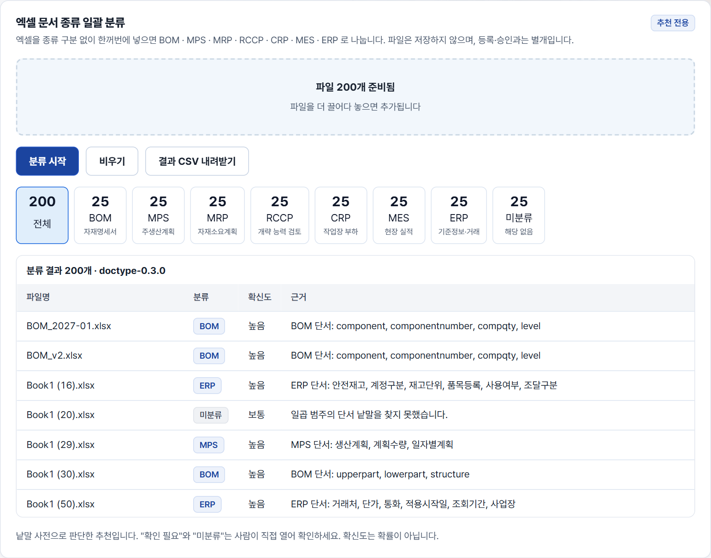

위는 데이터 업로드 화면에 더미 엑셀 200개를 끌어다 놓고 "분류 시작"을 누른 결과다.

## 목차

1. [전체 흐름](#1-전체-흐름)
2. [실제 엑셀 한 개로 따라가기](#2-실제-엑셀-한-개로-따라가기)
3. [어떤 모델을 쓰나](#3-어떤-모델을-쓰나)
4. [왜 이 방식인가](#4-왜-이-방식인가)
5. [처음 시작하기](#5-처음-시작하기)
6. [새 양식을 만났을 때 고치는 법](#6-새-양식을-만났을-때-고치는-법)
7. [성능](#7-성능)
8. [표 위치 찾기](#8-표-위치-찾기)
9. [서버에 올릴 수 있나](#9-서버에-올릴-수-있나)
10. [한계](#10-한계)
11. [구성과 연동](#11-구성과-연동)

## 1. 전체 흐름

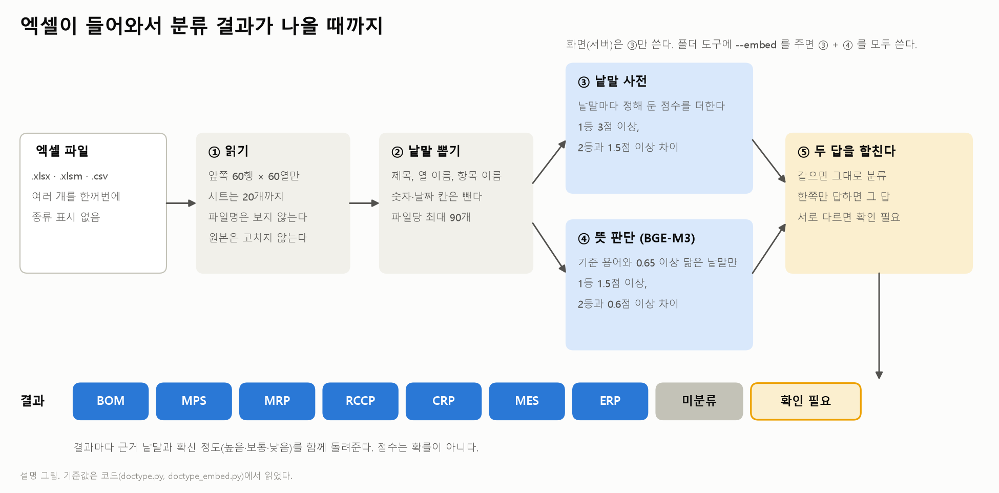

1. **읽기.** 엑셀의 앞쪽 60행 × 60열만 읽는다. 문서 종류는 제목과 열 이름에서 드러나므로 그 뒤는 필요 없다. 파일명은 보지 않는다.
2. **낱말 뽑기.** 제목, 열 이름, 항목 이름처럼 글자가 든 칸만 남기고 숫자와 날짜는 뺀다.
3. **낱말 사전.** 낱말마다 미리 정해 둔 점수를 종류별로 더한다. 빠르고 근거가 분명하다.
4. **뜻 판단.** 사전에 없는 낱말을 AI 모델로 뜻이 가까운 기준 용어에 연결해 점수를 더한다.
5. **합치기.** 두 답이 같으면 그대로 분류하고, 한쪽만 답하면 그 답을 쓰고, 서로 다르면 "확인 필요"로 돌린다.

결과는 아홉 가지 중 하나다.

| 결과 | 파일의 모습 |
|---|---|
| BOM | 제품별 구성품과 소요량 |
| MPS | 제품 × 주/월별 생산계획 수량 |
| MRP | 자재 × 기간별 총소요·예정입고·순소요·계획발주 |
| RCCP | 주요 설비 × 월별 필요시간과 가용시간 (개략) |
| CRP | 작업장·공정·오더별 상세 부하 |
| MES | 현장 실적 (양품·불량, 설비 가동, LOT) |
| ERP | 기준정보와 거래 (품목·거래처, 수주, 발주, 입고, 재고, 단가) |
| 미분류 | 위에 해당하지 않는 문서 |
| 확인 필요 | 분류기가 확신하지 못한 파일 |

## 2. 실제 엑셀 한 개로 따라가기

더미 데이터의 실제 파일 하나(`자료 (95).xlsx`, 주간 생산현황표)가 분류되는 과정이다. 그림의 숫자는 모두 실제 계산값이다. ④의 사전은 이 양식을 보기 전의 사전이다. 처음 보는 양식을 만났을 때 어떻게 되는지 보여 주려고 되돌렸고, 지금의 사전은 이 양식을 본 뒤라 혼자서도 MES로 분류한다.

**① 종류 표시 없이 섞여 있는 엑셀 200개가 들어온다.** 파일명은 `Book1.xlsx`, `수정본 (76).xlsx`처럼 내용을 알려 주지 않는다.

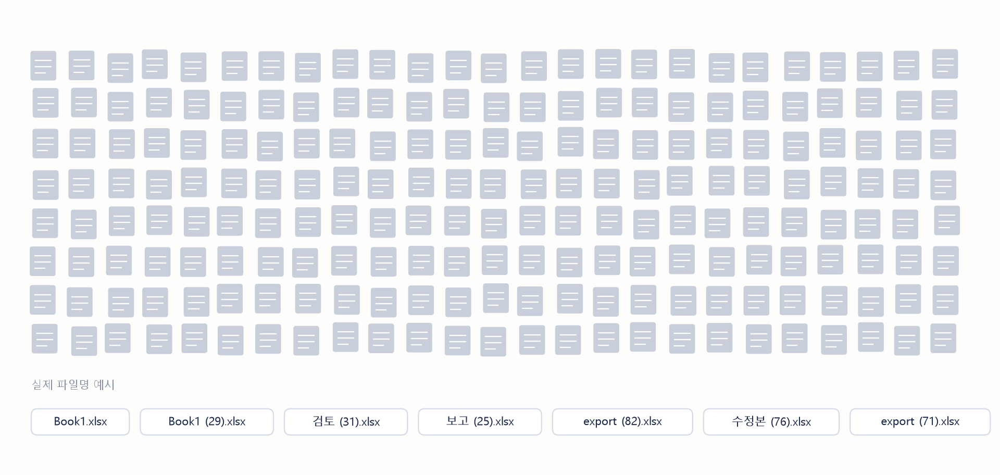

**② 그중 한 개를 연다.** 제목, 결재란, 열 이름이 뒤섞인 실제 서식 그대로다.

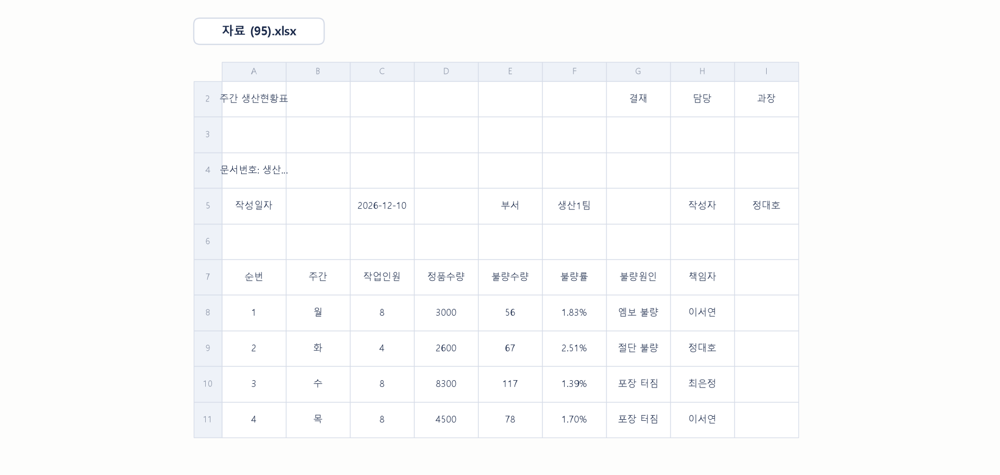

**③ 글자가 든 칸만 읽는다.** 주황 칸이 분류에 쓰는 낱말이고, 흐린 칸(숫자와 값)은 쓰지 않는다.

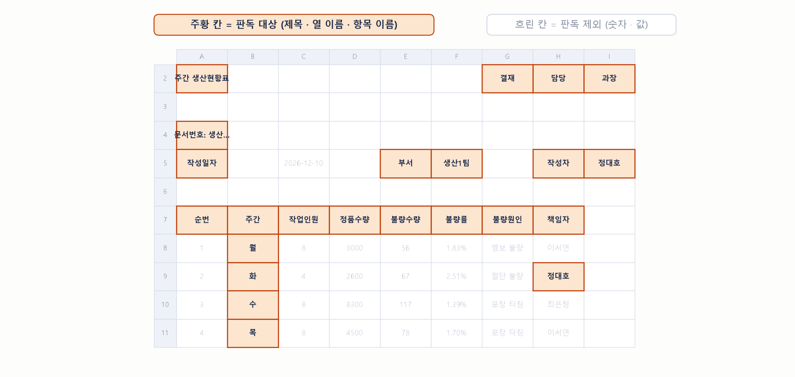

**④ 낱말을 사전과 대조한다.** 사전에 있는 낱말은 `불량수량`, `불량률`, `불량원인` 3개뿐이다. 점수가 2.0으로 필요한 3.0에 못 미쳐서, 사전만으로는 "모르겠다"고 넘긴다.

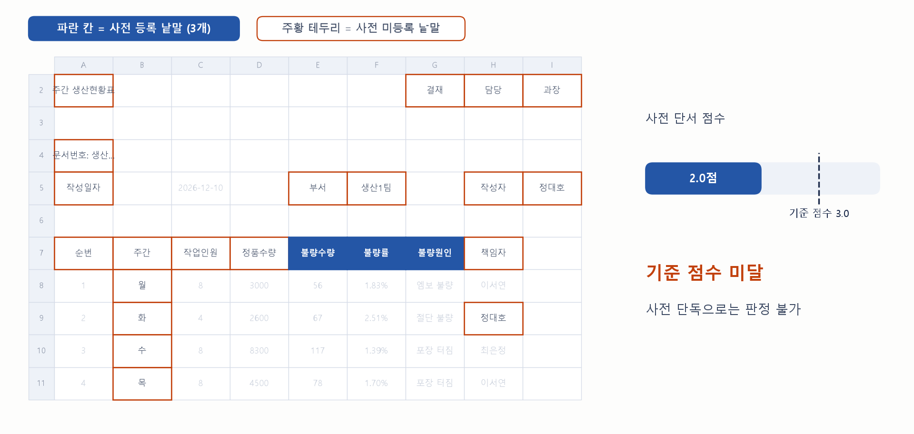

**⑤ 사전에 없는 낱말을 뜻이 가까운 용어에 연결한다.** `작업인원`은 사전에 없지만 `작업자`와 0.80만큼 닮았다. 0.65보다 덜 닮은 연결은 버린다. `정품수량`, `작성일자`처럼 어느 문서에나 나오는 `수량`, `일자`에 가장 가까운 낱말은 단서로 세지 않는다.

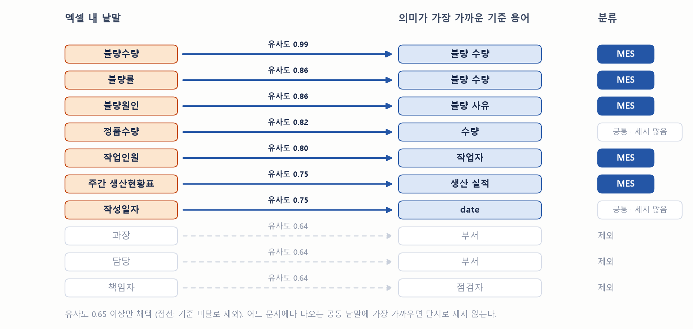

**⑥ 종류별로 점수를 더한다.** 현장 실적(MES)이 4.1점으로 필요한 1.3점을 넘고 2등(1.0점)을 크게 앞서서 MES로 분류한다. 정답이다.

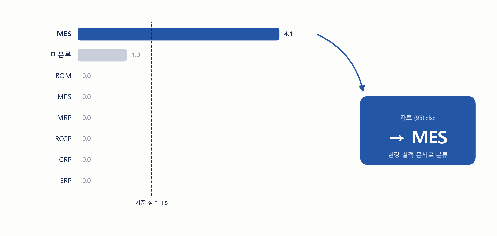

**⑦ 200개를 모두 이렇게 나눈다.**

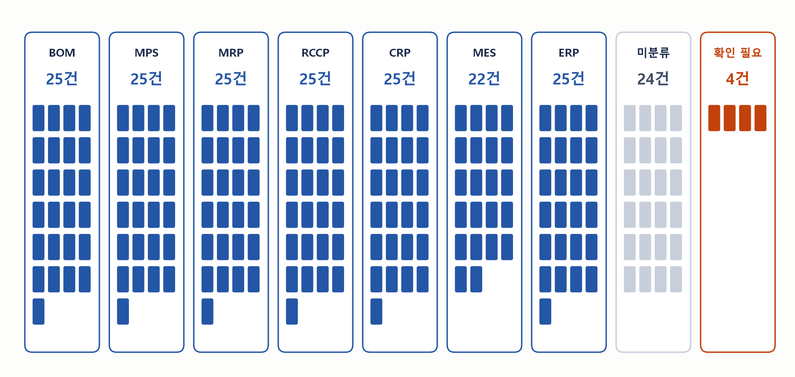

위 과정을 한 장에 모으면 아래와 같다.

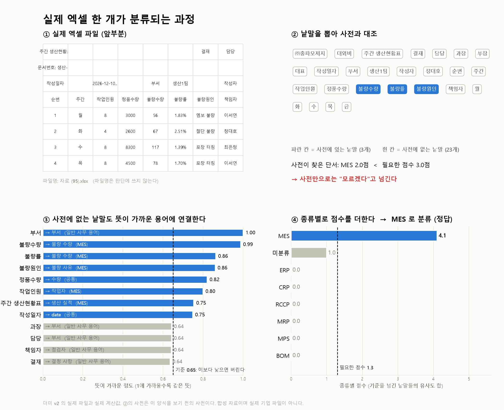

## 3. 어떤 모델을 쓰나

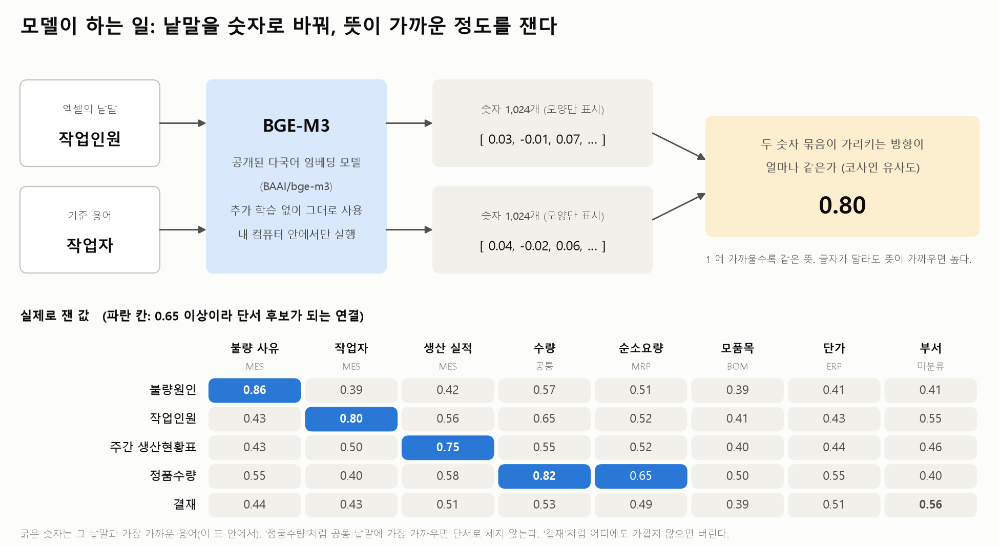

| 항목 | 내용 |
|---|---|
| 모델 | `BAAI/bge-m3` (BGE-M3). 한국어와 영어를 포함한 다국어 임베딩 모델로 공개돼 있다 |
| 하는 일 | 낱말 하나를 숫자 1,024개로 바꾼다. 뜻이 가까운 낱말은 숫자 묶음의 방향이 비슷해진다 |
| 학습 | **추가로 학습시키지 않았다.** 공개된 모델을 그대로 쓴다. 우리 데이터로 고친 부분은 없다 |
| 실행 위치 | 내 컴퓨터 안에서만 돈다. 엑셀 내용을 밖으로 보내지 않는다 |
| 비교 대상 | 종류별로 골라 둔 기준 용어 약 190개 (`doctype_embed.py`의 `CONCEPTS`) |
| 모델에 넣는 것 | 제목, 열 이름, 항목 이름. 품목 코드·전화번호·날짜 같은 값은 넣지 않는다 |
| 필요한 것 | torch, transformers. GPU가 있으면 빠르다 |

모델이 종류를 직접 맞히는 것이 아니다. 모델은 "이 낱말이 저 기준 용어와 뜻이 얼마나 가까운가"만 숫자로 알려 주고, 분류는 그 숫자를 더해서 정한다. 그래서 왜 그렇게 분류했는지를 "`작업인원` ≈ `작업자`"처럼 낱말로 설명할 수 있다.

기준 용어는 세 묶음이다.

- **일곱 종류의 용어**: `순소요량`(MRP), `양품 수량`(MES)처럼 그 종류에서만 주로 쓰는 말.
- **미분류 용어**: `사원 번호`, `회의 안건`처럼 제조 계획과 무관한 문서의 말. 여기에 더 가까우면 미분류로 본다.
- **공통 용어**: `품목명`, `수량`, `단위`처럼 어느 문서에나 나오는 말. 여기에 가장 가까운 낱말은 단서로 세지 않는다.

## 4. 왜 이 방식인가

### 낱말 사전만으로는 부족하다

사전은 빠르고 확실하지만, 회사마다 같은 것을 다르게 부른다(`양품수량`, `정품수량`, `합격수량`). 사전에 없는 표기를 만나면 그냥 넘겨 버린다. 새 양식을 만날 때마다 사람이 사전을 고쳐야 한다.

### 파일을 통째로 비교하면 구분이 안 된다

AI 모델로 파일 전체를 한 문장처럼 만들어 각 종류의 설명과 비교해 봤다. 같은 파일인데 모든 종류와 0.48~0.54로 비슷하게 닮아 보였고, 정답인 MES가 오히려 꼴찌였다. 낱말 하나하나를 따로 비교하면 한 종류가 뚜렷하게 올라온다.

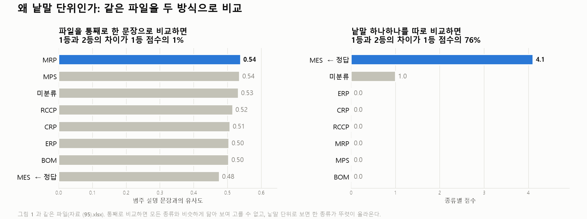

전체 109개 파일에서도 같았다. 1등과 2등의 차이가 통째 비교에서는 1등 점수의 3%에 그쳤고, 낱말 단위에서는 71%였다(중앙값).

### 덜 닮은 연결은 버려야 한다

모든 낱말을 가장 가까운 기준 용어에 연결하면 대부분은 엉뚱한 곳에 붙는다. 0.65보다 덜 닮은 연결 4,538개 중 92%가 틀린 종류였다. 그래서 0.65 이상만 단서로 쓴다.

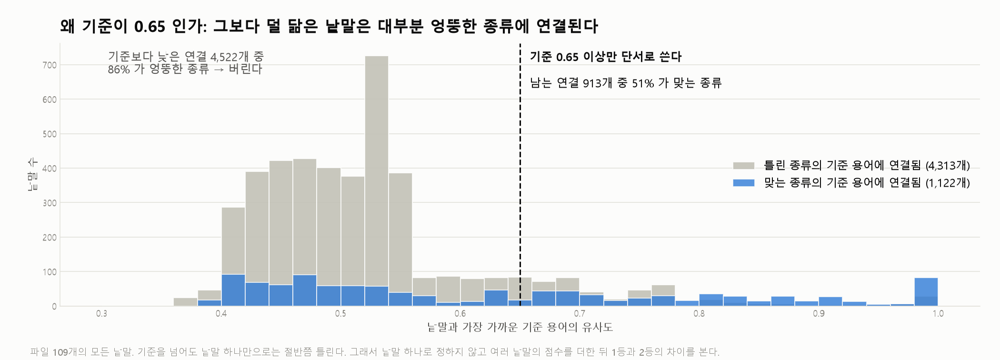

기준을 넘은 연결도 낱말 하나만 보면 41%만 맞는다. 그래서 낱말 하나로 정하지 않고, 여러 낱말의 점수를 더한 뒤 1등과 2등의 차이가 충분할 때만 분류한다.

### 두 방법이 서로를 확인해 준다

사전과 뜻 판단을 각각 돌려 답을 비교했다.

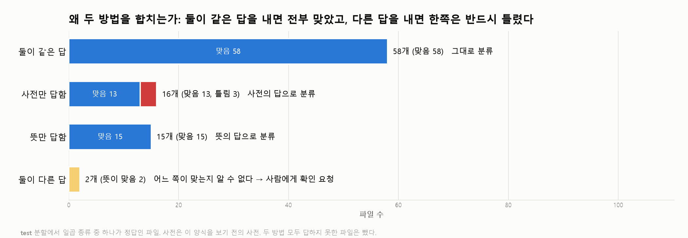

- **둘이 같은 답을 낸 61개는 전부 맞았다.** 그대로 분류한다.
- **한쪽만 답한 34개 중 31개가 맞았다.** 답한 쪽을 따른다. 뜻 판단 혼자 맞힌 21개는 사전만 썼다면 놓쳤을 파일이다.
- **틀린 3개는 모두 사전 혼자 답한 경우였다.** `Work center` 한 낱말로 CRP라고 답했는데 실제로는 MES였다. 그래서 사전의 확신이 높지 않고 뜻 판단에서 다른 종류의 점수가 더 높으면 사람에게 확인을 요청한다. 이 3개가 지금은 "확인 필요"로 간다.
- **둘이 다른 답을 낸 2개는 한쪽이 반드시 틀렸다.** 어느 쪽인지 알 수 없으므로 사람에게 확인을 요청한다.

이 결과를 규칙으로 옮긴 것이 아래 표다.

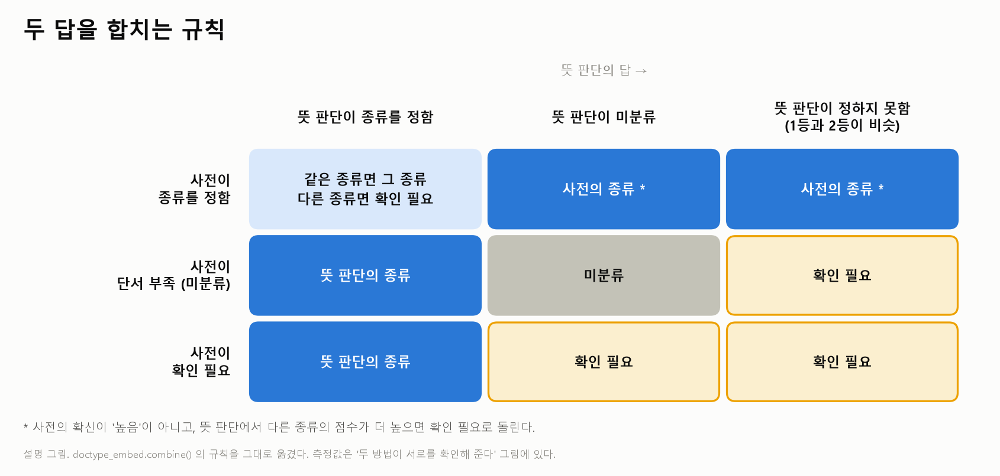

## 5. 처음 시작하기

쓰는 방법은 세 가지다. 화면은 사전만 쓰고, 폴더 도구는 뜻 판단까지 쓸 수 있다.

| 방법 | 쓰는 것 | 필요한 것 |
|---|---|---|
| 화면에 끌어다 놓기 | 사전 | 백엔드와 프론트엔드 서버 |
| 폴더 도구 | 사전 | Python, openpyxl |
| 폴더 도구 + `--embed` | 사전 + 뜻 판단 | 위에 더해 torch, transformers. GPU 권장 |

### 화면에서 쓰기

1. 백엔드와 프론트엔드를 띄운다.

   ```powershell
   # 저장소 루트에서. 창 두 개에 각각 실행한다
   cd backend; ..\.venv\Scripts\python.exe -m uvicorn app.main:app --host 127.0.0.1 --port 8000
   cd frontend; npm run dev
   ```

2. `http://127.0.0.1:5173`의 "데이터 업로드" 화면 맨 위에 있는 아래 영역에 엑셀 파일이나 폴더를 끌어다 놓는다.

   

3. "분류 시작"을 누른다. 종류별 개수를 누르면 그 종류만 볼 수 있고, "결과 CSV 내려받기"로 목록을 저장할 수 있다.

화면은 `POST /classifications/documents`를 부른다. 파일을 저장하지 않고 DB를 쓰지 않으며, 등록·승인 절차와는 별개다. 한 번에 50개, 파일당 10MB까지 받고 화면이 25개씩 나눠 보낸다.

### 폴더 도구로 쓰기

```powershell
# 폴더를 통째로 분류해 결과 엑셀을 만든다 (낱말 사전만)
python -X utf8 modules/file_classifier/tools/sort_folder.py <폴더> --out 분류결과.xlsx

# 낱말의 뜻까지 함께 쓴다 (권장)
python -X utf8 modules/file_classifier/tools/sort_folder.py <폴더> --out 분류결과.xlsx --embed

# 저장소에 든 더미 200개로 바로 해 보기 (정답과 비교해 채점까지)
python -X utf8 modules/file_classifier/tools/sort_folder.py modules/file_classifier/samples/inbox --labels modules/file_classifier/samples/labels.json --embed
```

결과 엑셀에는 파일명, 분류, 확신 정도, 근거가 적힌다. 원본 파일은 읽기만 하고 옮기거나 고치지 않는다.

`--embed`를 처음 쓸 때 알아 둘 점이다.

- **모델을 한 번 내려받는다.** 처음 실행하면 Hugging Face에서 BGE-M3를 자동으로 받아 PC에 저장한다(이 PC에서는 저장 폴더가 4.3GB였다). 이때만 인터넷이 필요하고, 엑셀 내용은 보내지 않는다.
- **확인한 환경**: Python 3.11.9, torch 2.6.0(CUDA 12.4), transformers 5.22.2, NVIDIA RTX 4060 Laptop. 이 환경은 저장소 `.venv`가 아니라 별도 가상환경이다. 백엔드용 `.venv`에는 torch를 넣지 않았다.
- **GPU가 없으면** CPU로 돈다. CPU에서의 속도는 재지 않았다.

### 코드에서 부르기

```python
from file_classifier.doctype_io import classify_bytes

result = classify_bytes("자료.xlsx", open("자료.xlsx", "rb").read())
print(result["category"], result["confidence"], result["reason"])
```

읽지 못한 파일(깨진 파일, 암호가 걸린 파일)은 예외를 던지지 않고 `확인 필요`와 이유를 돌려준다.

## 6. 새 양식을 만났을 때 고치는 법

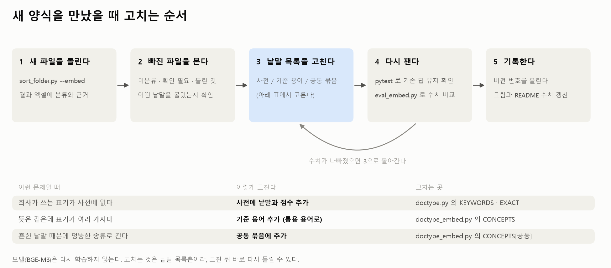

고치는 것은 낱말 목록뿐이고 모델은 건드리지 않는다. 문제에 따라 고치는 곳이 다르다.

| 문제 | 고치는 곳 | 예 |
|---|---|---|
| 회사가 쓰는 표기가 사전에 없다 | `doctype.py`의 `KEYWORDS`(낱말이 들어 있으면 점수), `EXACT`(정확히 일치할 때만 점수) | `("합격수량", 2)`를 MES에 추가 |
| 뜻은 같은데 표기가 여러 가지다 | `doctype_embed.py`의 `CONCEPTS`에 기준 용어 추가 | MES에 `"재작업 수량"` 추가 |
| 흔한 낱말 때문에 엉뚱한 종류로 간다 | `doctype_embed.py`의 `CONCEPTS["공통"]`에 추가 | `"거래 일자"` 추가 |

고친 뒤에는 반드시 다시 잰다.

```powershell
# 기존에 맞히던 답이 그대로인지 확인 (시험 345개)
./.venv/Scripts/python.exe -m pytest modules/file_classifier -q

# 처음 보는 양식 109개의 수치가 나빠지지 않았는지 확인 (GPU 권장)
python -X utf8 modules/file_classifier/tools/eval_embed.py

# 그림과 그림에 쓴 숫자 다시 만들기
python -X utf8 modules/file_classifier/tools/make_figures.py
python -X utf8 modules/file_classifier/tools/make_principle_figures.py
python -X utf8 modules/file_classifier/tools/make_flow_figures.py
python -X utf8 modules/file_classifier/tools/make_readme_figures.py --compute
```

지켜야 할 것이 세 가지 있다.

- **버전 번호를 올린다.** 사전을 고치면 `doctype.py`의 `VERSION`, 기준 용어를 고치면 `doctype_embed.py`의 `VERSION`을 올린다. 결과에 버전이 함께 찍혀서 어느 목록으로 분류했는지 알 수 있다.
- **기준 용어는 통용 용어로 넣는다.** 특정 파일의 열 이름을 그대로 넣으면 그 파일만 맞히게 된다.
- **고친 뒤의 수치는 "처음 보는 양식" 수치가 아니다.** 본 파일에 맞춰 고쳤기 때문이다. 실력을 재려면 고치는 데 쓰지 않은 파일이 따로 있어야 한다.

실제로 이렇게 고친 사례가 두 번 있다. 하나는 [기준을 고친 기록](#기준을-고친-기록)에 있고, 다른 하나는 아래와 같다. 팀원이 만든 자료를 넣었더니 `자재코드`, `단위` 같은 흔한 열 이름이 BOM 용어에 붙어 자재 목록을 BOM으로 분류했다. 공통 묶음을 만들어 넣자 틀린 분류가 3건에서 0건이 됐다. 자세한 내용은 [7. 성능](#다른-사람이-만든-자료로-확인)에 있다.

더미 데이터를 다시 만들 때는 아래를 쓴다. 파일명과 정답은 바뀌지 않는다.

```powershell
python -X utf8 modules/file_classifier/samples/make_samples.py
```

## 7. 성능

**처음 보는 양식의 엑셀 100개 중 94개를 맞게 분류하고, 틀리게 분류한 것은 없다.** 사전만 쓰던 이전에는 75개를 맞히고 5개를 틀렸다.


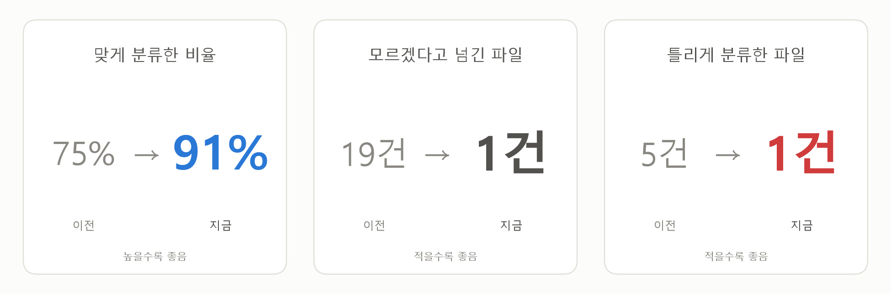

- **맞게 분류한 비율이 75%에서 94%로 올랐다.**
- **"모르겠다"고 넘기던 파일이 19건에서 1건으로 줄었다.** 사전에 없는 낱말이 나와도 뜻으로 알아본다.
- **틀리게 분류한 파일이 5건에서 0건으로 줄었다.** 확신이 없는 5건은 사람에게 확인을 요청한다.

약하던 문서 종류일수록 많이 올랐다. 현장 실적(MES)은 27%에서 73%로, BOM은 62%에서 100%로, 설비 부하 검토(RCCP)는 67%에서 100%로 올랐다.

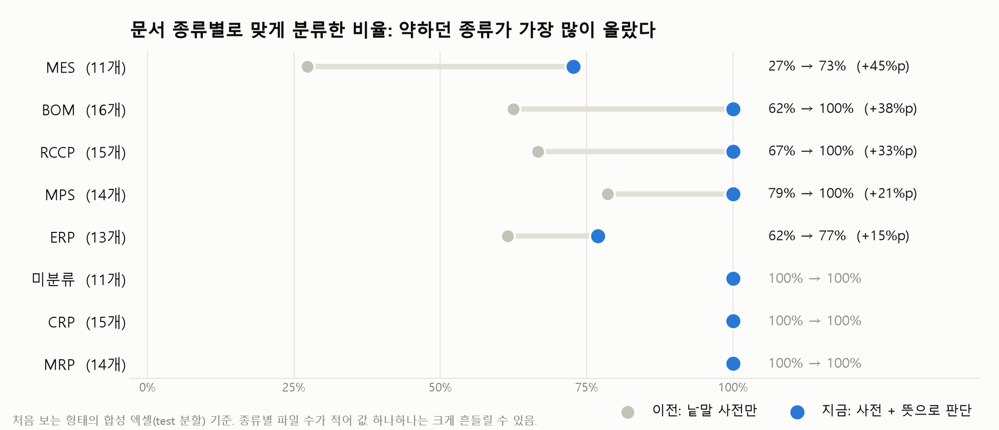

여러 방식을 시험했고, 효과가 있는 것만 남겼다.

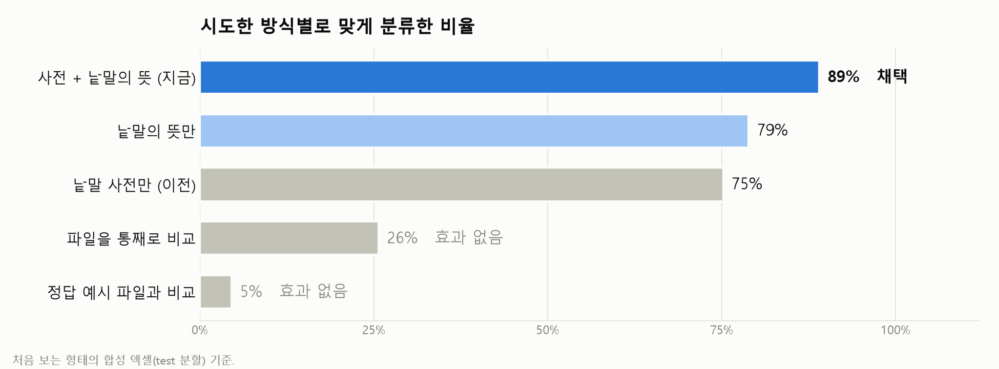

### 숫자를 읽을 때 알아 둘 점

- 위 결과는 분류기가 **본 적 없는 양식**의 엑셀 109개로 잰 값이다. "사전만"은 이 양식을 보기 전의 사전으로 되돌려서 쟀다.
- 엑셀은 실제 문서 형태를 본떠 만든 합성 자료다. 실제 기업 파일로 잰 값은 아니다.
- 화면은 사전만 쓴다. 화면에서 처음 보는 양식을 넣으면 94%가 아니라 사전만의 수치에 가깝게 나온다.
- **94%는 틀린 파일을 본 뒤에 고친 수치다.** 고치기 전에는 89%였다(맞음 97, 확인 요청 2, 넘김 7, 틀림 3). 틀린 12개를 들여다보고 기준 두 가지를 고쳤으므로, 이 109개는 더 이상 "한 번도 보지 않은" 시험이 아니다. 아래 "기준을 고친 기록"에 무엇을 왜 고쳤는지 적었다.

### 자세한 수치

처음 보는 양식 기준(더미의 test 분할 109개).

| 구성 | 맞게 분류 | 확인 요청 | 모르겠다고 넘김 | 틀리게 분류 |
|---|---|---|---|---|
| 사전만 | 82 (75.2%) | 3 | 19 | 5 |
| 뜻만 | 95 (87.2%) | 3 | 11 | 0 |
| 사전 + 뜻 (고치기 전, `doctype-embed-0.2.0`) | 97 (89.0%) | 2 | 7 | 3 |
| **사전 + 뜻 (지금, `doctype-embed-0.3.0`)** | **103 (94.5%)** | 5 | 1 | 0 |

이미 본 양식 기준(전체 200개, 지금의 사전).

| 구성 | 맞게 분류 | 확인 요청 | 모르겠다고 넘김 | 틀리게 분류 |
|---|---|---|---|---|
| 사전만 | 200 | 0 | 0 | 0 |
| 사전 + 뜻 | 200 | 0 | 0 | 0 |

- 처리시간: 파일당 약 14ms(사전만), 약 57ms(사전 + 뜻, GPU, 모델을 올리는 시간 제외). CPU에서는 재지 않았다.
- 기준값: 사전은 1등 3.0점 이상, 2등과 1.5점 이상 차이. 뜻 판단은 낱말 유사도 0.65 이상만 세고, 1등 1.3점 이상, 2등과 0.6점 이상 차이. 점수는 확률이 아니다.
- 낱말을 일부러 가려 본 결과(사전만, 200개): 글자 칸의 절반을 모르는 낱말로 바꿔도 틀리게 분류한 것은 0건이었다.

### 기준을 고친 기록

2026-11-23에 처음 보는 양식에서 못 맞힌 12개를 하나씩 들여다보고 두 가지를 고쳤다(`doctype-embed-0.3.0`).

| 못 맞힌 파일 | 개수 | 원인 | 고친 것 |
|---|---|---|---|
| BOM 구조표 | 6 | 낱말 두 개가 0.72, 0.69로 BOM 용어에 연결됐지만 합이 1.41점이라 필요한 1.5점에 못 미쳤다 | 필요한 점수를 1.3으로 낮췄다. 1.3은 기준 유사도 0.65의 두 배로, "서로 다른 기준 용어 2개에 연결되면 통과"라는 뜻이다 |
| SAP 실적 확인 (MES) | 3 | 사전이 `Work center` 한 낱말로 CRP라고 답했고, 뜻 판단은 답을 못 내서 사전의 틀린 답이 그대로 나갔다 | 사전의 확신이 높지 않고 뜻 판단에서 다른 종류의 점수가 더 높으면 확인 필요로 돌린다 |
| 재고 현황 (ERP) | 2 | 사전은 MES, 뜻 판단은 ERP | 고치지 않았다. 확인 필요로 가는 것이 맞다 |
| 거래처 목록 (ERP) | 1 | 단서가 `Customer` 하나뿐이다 | 고치지 않았다 |

- 필요한 점수는 1.0부터 1.4까지 어느 값으로 잡아도 결과가 같았다. 값 하나에 민감하지 않다.
- 유사도 기준을 0.65에서 0.62로 낮추는 방법도 시험했지만 맞게 분류한 것이 101개에 그치고 확인 요청이 늘어서 쓰지 않았다.
- 이미 본 양식 200개의 결과는 그대로다(200개 모두 맞음).

### 다른 사람이 만든 자료로 확인

위 수치는 모두 내가 만든 더미로 잰 것이라, 2026-11-22에 이희원 담당 합성 자료(CHUNGPAMO-2027)의 CSV 중 양식이 서로 다르고 종류가 분명한 22개를 넣어 봤다. 정답은 파일 성격을 보고 내가 정했다.

| 구성 | 맞게 분류 | 확인 요청 | 모르겠다고 넘김 | 틀리게 분류 |
|---|---|---|---|---|
| 사전만 | 16 | 1 | 5 | 0 |
| 사전 + 뜻 (공통 낱말 묶음 넣기 전) | 13 | 4 | 2 | 3 |
| 사전 + 뜻 (공통 낱말 묶음 넣은 뒤, `0.2.0`) | 17 | 1 | 4 | 0 |
| **사전 + 뜻 (지금, `0.3.0`)** | **18** | 2 | 2 | 0 |

- 처음에는 뜻 판단을 더하면 오히려 나빠졌다. `자재코드`, `자재명`, `단위` 같은 흔한 열 이름이 BOM 용어(`자재명세서`, `자품목`, `단위 소요량`)에 붙어서 자재 목록, 자재투입내역, 재고수불부를 BOM으로 분류했다.
- 그래서 어느 문서에나 나오는 낱말을 모은 "공통" 묶음을 만들고, 여기에 가장 가까운 낱말은 단서로 세지 않게 했다(`doctype-embed-0.2.0`). 틀리게 분류한 것이 3건에서 0건이 됐다.
- 대신 내 더미의 "처음 보는 양식" 수치는 91%에서 89%로 내려갔다. 이전에 맞힌 것 중 일부는 `Quantity` 같은 흔한 낱말이 우연히 맞는 종류에 붙어서 얻은 점수였다.
- 2026-11-23에 기준을 고친 뒤에는 17개에서 18개로 늘었다. 이 자료는 기준을 고칠 때 들여다보지 않았으므로, 더미에만 맞춘 것이 아니라는 약한 근거가 된다.
- 22개뿐이라 한두 건에 수치가 크게 달라진다. 제목 없이 열 이름만 있는 CSV라서 엑셀 서식보다 단서가 적다. 공통 묶음은 이 자료를 본 뒤에 만들었으므로 이 표도 완전히 독립적인 시험은 아니다.

## 8. 표 위치 찾기

실제 사무실 엑셀은 1행이 머리글이 아니다. 위에 제목, 결재란, "작성일자: …" 줄이 있고 한 시트에 표가 여러 개 있기도 하다. 문서 종류를 맞혀도 표가 어디인지 모르면 등록으로 이어지지 않는다. 그래서 모델 없이 칸의 모양(글자인가 숫자인가, 비었는가, 병합됐는가)만 보고 표의 머리글 행, 데이터 행, 열 범위를 찾는 기능을 만들었다(`tables-0.1.0`).

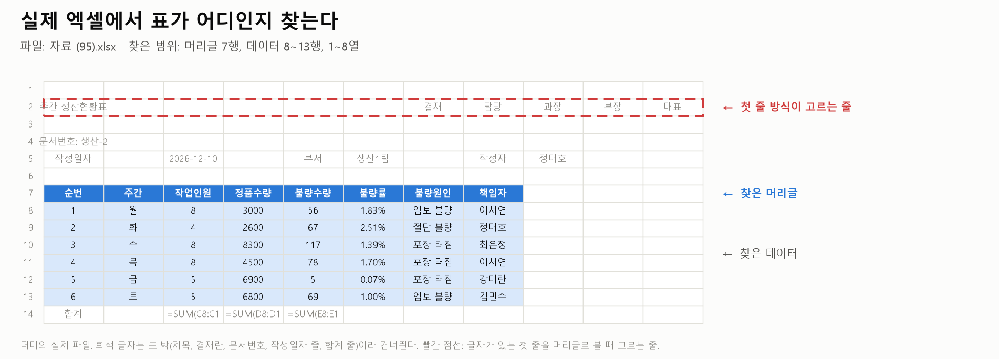

찾는 방법은 다섯 가지 규칙이다.

1. **머리글 후보**: 비지 않은 칸이 2개 이상 이어지고 첫 칸이 글자인 행. 가로로 병합된 칸이 있으면 머리글이 아니다.
2. **아래에 값이 있어야 한다.** 결재란은 아래가 비어 있어서 걸러진다.
3. **바로 아래에 더 긴 줄이 있으면 그 줄이 머리글이다.** 지금 줄은 표 위의 "항목: 값" 줄이나 묶음 머리글이다.
4. **데이터는 빈 행을 만날 때까지다.** 마지막 행이 `합계`, `계`, `Total`로 시작하면 합계 행으로 보고 데이터에서 뺀다.
5. **데이터가 2행 이상이어야 표로 본다.** "부서: 생산1팀" 같은 줄을 표로 보지 않기 위해서다.

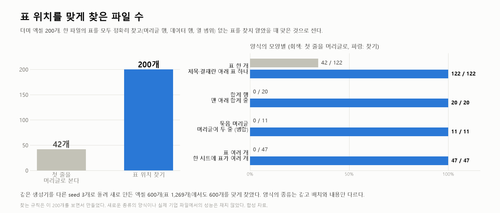

| 자료 | 글자가 있는 첫 줄을 머리글로 본다 | 표 위치 찾기 |
|---|---|---|
| 저장소의 더미 200개 (표 422개) | 42개 파일 | **200개 파일** (표 422개 모두) |
| 다른 seed로 새로 만든 600개 (표 1,269개) | 131개 파일 | **600개 파일** (표 1,269개 모두) |

- 한 파일의 표를 모두 정확히 찾고(머리글 행, 데이터 행, 열 범위) 없는 표를 찾지 않았을 때 맞은 것으로 셌다.
- 김대영 님의 [검증](../../docs/CLASSIFIER_XLSX_MAPPING_VERIFICATION_20261123.md)에서 지금의 업로드 파서가 실제 머리글을 포함한 파일은 200개 중 18개였다.
- **백엔드의 표 범위 선택과 맞물린다.** 찾은 첫 표의 범위를 `POST /classifications/file`의 `table_selection`에 그대로 넣었더니 200개 모두 받아들여졌다(병합·머리글 오류 0건). 좌표의 뜻이 같아서 변환이 필요 없다.
- 범위를 넣어도 200개 중 192개는 여전히 보류다. 더미 대부분이 보고서라서 등록 대상 5종이 아니기 때문이며, 표를 못 읽어서가 아니다.

```python
from file_classifier.tables import find_tables_in_xlsx

for t in find_tables_in_xlsx(open("자료.xlsx", "rb").read()):
    print(t.sheet, t.header_row, t.data_start_row, t.data_end_row, t.first_col, t.last_col, t.total_row)
```

**숫자를 읽을 때 알아 둘 점**

- **규칙을 이 200개를 보면서 만들었다.** 처음에는 178개였고, 못 찾은 파일을 보고 규칙을 고쳐 200개가 됐다. 그래서 200개는 "본 양식"의 수치다.
- 새로 만든 600개는 같은 생성기를 다른 seed로 돌린 것이다. 표가 놓이는 자리, 표 개수, 항목 줄, 꾸밈은 달라지지만 양식의 종류는 같다. 새로운 종류의 양식에서의 성능은 재지 않았다.
- 데이터가 한 행뿐인 표, 머리글 없이 값만 있는 표, 왼쪽에 머리글이 세로로 놓인 표는 찾지 못한다.
- 찾은 범위는 제안이다. 사람이 확인해야 하고, 화면과 API에는 아직 연결하지 않았다.

## 9. 서버에 올릴 수 있나

화면은 사전만 써서 처음 보는 양식에 약하다. 뜻 판단을 서버(CPU)에 올릴 수 있는지 세 가지를 쟀다.

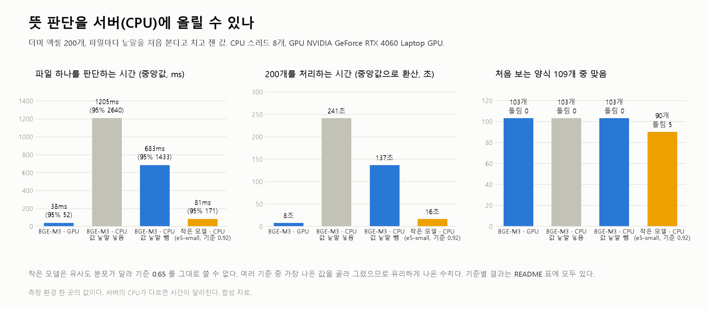

| 구성 | 파일당 시간 (중앙값 / 95%) | 200개 환산 | 처음 보는 양식 109개 |
|---|---|---|---|
| BGE-M3, GPU | 38ms / 52ms | 약 8초 | 103 / 5 / 1 / 0 |
| BGE-M3, CPU, 값 낱말 넣음 | 1,205ms / 2,640ms | 약 4분 | 103 / 5 / 1 / 0 |
| **BGE-M3, CPU, 값 낱말 뺌** | **683ms / 1,433ms** | 약 2분 17초 | 103 / 5 / 1 / 0 |
| 작은 모델(e5-small), CPU, 기준 0.92 | 81ms / 171ms | 약 16초 | 90 / 3 / 11 / 5 |

정확도 칸은 `맞음 / 확인 필요 / 놓침 / 틀림`이다.

- **값 낱말을 빼면 결과는 같고 CPU 시간이 43% 줄어든다.** 품목 코드(`CP-R4-2730`), 전화번호, 날짜처럼 값으로 보이는 글자는 뜻을 담고 있지 않다. 넣어도 기준 0.65를 넘는 일이 없어서 세 자료 모두 결과가 같았고, 모델에 넣는 낱말만 파일당 48개에서 24개로 줄었다. 이 필터는 코드에 반영했다(`doctype-embed-0.3.1`).
- **BGE-M3를 CPU에서 돌리면 파일 하나에 0.7초쯤 걸린다.** 한두 개를 올릴 때는 쓸 만하고, 200개를 한꺼번에 넣으면 2분 넘게 기다려야 한다. 화면에 붙인다면 진행 표시가 필요하다.
- **작은 모델은 빠르지만 쓰지 않는다.** 8배쯤 빠른 대신 맞게 분류한 것이 103개에서 90개로 줄고 틀린 분류가 0건에서 5건이 된다. 사전만 쓸 때(82개, 틀림 5건)와 비교해도 틀린 분류가 줄지 않는다.

작은 모델(`intfloat/multilingual-e5-small`)은 유사도 분포가 달라 기준을 새로 잡아야 했다. 넣어 본 기준별 결과는 아래와 같고, 위 표에는 가장 나은 값을 적었다.

| 기준 유사도 | 처음 보는 양식 109개 | 본 양식 200개 |
|---|---|---|
| 0.86 | 88 / 13 / 2 / 6 | 188 / 12 / 0 / 0 |
| 0.88 | 85 / 8 / 11 / 5 | 194 / 6 / 0 / 0 |
| 0.90 | 84 / 9 / 11 / 5 | 192 / 8 / 0 / 0 |
| 0.92 | 90 / 3 / 11 / 5 | 200 / 0 / 0 / 0 |

**숫자를 읽을 때 알아 둘 점**

- 측정 환경: Python 3.11.9, torch 2.6.0, CPU 스레드 8개, NVIDIA RTX 4060 Laptop, 2026-11-23. 한 대에서 한 번 잰 값이고, 서버의 CPU가 다르면 달라진다.
- 시간은 모델을 올린 뒤에, 파일마다 낱말을 처음 본다고 치고 쟀다. 모델을 올리는 데는 5~8초가 따로 걸린다.
- **메모리는 제대로 재지 못했다.** 한 프로세스에서 여러 모델을 차례로 올려서 값이 섞였다. 참고로 김대영 님의 [평가](../../docs/MAPPING_BGE_EVALUATION_20261122.md)에서는 CPU용 BGE-M3가 약 1.5GiB를 썼다.
- 작은 모델의 기준은 이 109개를 보고 골랐으므로 유리하게 나온 수치다. 그런데도 BGE-M3보다 낮다.
- 속도를 더 줄이는 방법(ONNX 변환, 양자화, 낱말 벡터를 저장해 두기)은 해 보지 않았다.

## 10. 한계

- **실제 기업 파일로는 재지 않았다.** 더미는 가상 회사(㈜충파모제지) 한 곳의 합성 자료다. 표 형태는 공개 자료에서 확인한 것을 본떴지만 수치는 가정이다.
- **화면에는 뜻 판단이 연결돼 있지 않다.** 서버에 torch와 모델을 올리지 않아서 화면은 사전만 쓴다. 뜻 판단은 폴더 도구에서만 쓸 수 있다. CPU에서는 파일 하나에 0.7초쯤 걸린다(9절).
- **표 위치 찾기는 화면과 API에 연결돼 있지 않고, 규칙을 더미를 보면서 만들었다.** 새로운 종류의 양식에서는 재지 않았다(8절).
- 국내 ERP(더존, 이카운트, 영림원)의 실제 내려받기 양식과 SAP 화면의 열 이름은 공개 자료에서 글자로 확인하지 못했다.
- "처음 보는 양식" 측정도 완전히 독립적이지는 않다. 뜻 판단에 쓰는 기준 용어는 통용 용어로 골랐지만 더미를 본 뒤에 썼다.
- ERP는 "다른 여섯 종류에 해당하지 않는 기준정보·거래 자료"로 정의했다. 경계와 기준값은 팀 합의가 필요하다.
- 화면에서 파일 탐색기로 직접 끌어다 놓는 동작은 자동 시험으로 확인하지 못했다. 파일 선택과 끌어다 놓기 이벤트로만 확인했다.

다음 단계: 팀이나 수요기업의 실제 엑셀을 받아 `sort_folder.py --embed`로 그대로 돌려 본다.

## 11. 구성과 연동

| 경로 | 내용 |
|---|---|
| `src/file_classifier/doctype.py` | 낱말 사전 규칙 (`doctype-0.3.0`) |
| `src/file_classifier/doctype_embed.py` | 낱말의 뜻으로 판단, 사전과 합치기 (`doctype-embed-0.3.1`) |
| `src/file_classifier/tables.py` | 표 위치 찾기 (`tables-0.1.0`) |
| `src/file_classifier/doctype_io.py` | 파일 내용을 받아 분류 결과를 돌려준다. 서버가 쓴다 |
| `src/file_classifier/rules.py`, `__init__.py` | 업로드 화면용 테이블 분류 (`rules-0.4.0`, 아래 "이전 연구 요약" 참고) |
| `tools/sort_folder.py` | 폴더 일괄 분류 → 결과 엑셀 |
| `tools/eval_embed.py` | 처음 보는 양식 수치 재기 |
| `tools/eval_tables.py`, `eval_tables_api.py` | 표 위치 찾기 채점, 백엔드의 표 범위 선택에 넣어 보기 |
| `tools/eval_speed.py` | 장치별 속도, 작은 모델과 비교 |
| `tools/make_figures.py`, `make_principle_figures.py`, `make_flow_figures.py`, `make_readme_figures.py`, `make_research_figures.py` | 이 문서의 그림 만들기 |
| `samples/make_samples.py`, `samples/labels.json`, `samples/inbox/` | 더미 엑셀 200개 생성기, 정답, 파일 |
| `figures/` | 이 문서의 그림과 그림에 쓴 숫자(`numbers.json`, `principle_numbers.json`, `readme_numbers.json`, `tables_numbers.json`, `tables_api_numbers.json`, `speed_numbers.json`) |
| `tests/` | 시험 345개 |
| [PROGRESS.md](PROGRESS.md) | 이 모듈의 진행 기록 (지금 상태, 남은 일, 날짜별 기록) |

그림 중 `s1_dropzone.png`, `s2_sorted.png`는 화면을 찍은 것이라 스크립트로 다시 만들지 않는다.

시험용 엑셀 200개(`samples/inbox/`, 모두 합성 자료)는 바로 열어 볼 수 있게 저장소에 올려 두었다. 저장소 `.gitignore`가 `.xlsx`를 막고 있어 이 폴더만 `git add -f`로 올렸으므로, 생성기를 고쳐 다시 만들었을 때도 같은 방법으로 올린다. 결과 파일(`분류결과*.xlsx`)은 올리지 않는다.

### 다른 모듈과의 연동

- **문서 종류 분류**: 백엔드 `POST /classifications/documents`와 데이터 업로드 화면의 "엑셀 문서 종류 일괄 분류" 영역에 연결돼 있다. 사전만 쓴다.
- **표 위치 찾기**(`tables-0.1.0`): 연결돼 있지 않다. 백엔드의 표 범위 선택(`table_selection`)에 그대로 넣을 수 있는 좌표를 돌려준다.
- **업로드용 테이블 분류**(`rules-0.4.0`): 백엔드 분류 API, 컬럼 매핑 추천, 화면의 "파일 유형 추천" 패널에 연결돼 있다. 열 이름을 보고 product / material / bom / inventory / monthly_demand 중 하나를 추천하거나 보류한다. 보류할 때는 이유의 종류(`hold_kind`: 변환 필요, 다른 등록 경로, 모호함, 근거 부족)를 함께 돌려준다.
- 팀 공식 합성 자료(CHUNGPAMO-2027) 48개 파일로 확인한 결과와 다른 담당자에게 요청한 사항은 [CONTRACT_REQUESTS.md](CONTRACT_REQUESTS.md)에 있다.

---

## 이전 연구 요약

여기까지 오면서 시험한 것들이다. 자세한 수치는 Git 기록의 이전 README에 있다.

| 시도 | 결과 | 배운 것 |
|---|---|---|
| 임베딩 검색으로 열 이름 매핑 (별도 저장소 `retriever-eval`) | 순위는 잘 매기지만 오매핑 9~38% | 뜻만 보면 "비슷하지만 다른 것"을 틀린다. 규칙이 먼저 판정해야 한다 |
| 업로드 화면용 테이블 분류 (`rules.py`, 5종 추천) | 자체 사례 263건 전부 정답. 남이 만든 열 이름 2,500건에서는 62% → 고친 뒤 98%, 오분류 0건 | 문제와 답을 같은 사람이 만들면 점수가 부풀려진다 |
| 문서 종류 분류, 깔끔한 더미(v1) | 88.5% → 97.5% | 더미가 실제 문서와 너무 달랐다 |
| 실제 형태를 본뜬 더미(v2)로 교체 | 사전을 고치지 않으면 68%, 고치면 100% | 새 양식을 만날 때마다 60~70%대로 떨어진다. 사전만으로는 한계가 있다 |
| 파일을 통째로 임베딩해 비교 | 26% | 효과 없음 |
| 정답 예시 파일과 비교 (kNN) | 5% | 다른 양식의 예시는 도움이 안 된다 |
| **낱말 단위로 뜻을 비교해 사전과 합침** | **75% → 89%** | 채택 |
| 못 맞힌 파일을 보고 기준 두 가지를 고침 | 89% → 94%, 오분류 3 → 0 | 이 문서의 결과. 본 뒤에 고친 수치라는 점을 함께 적는다 |

2026-11-22에 더미 200개를 같은 파일명·같은 표·같은 정답으로 다시 만들면서 실제 사무실 엑셀의 겉모습(글꼴, 머리글 색, 결재란, 숫자·날짜 서식)과 쓰던 흔적(형광펜, 메모, 숨긴 열, 빈 시트 등)을 더했다. 겉모습은 분류 결과에 영향을 주지 않았다.

## 출처

- Oracle Capacity User's Guide 12.1, Rough Cut Capacity Planning: https://docs.oracle.com/cd/E18727_01/doc.121/e15189/T473818T474769.htm
- Oracle Master Scheduling/MRP 12.1: https://docs.oracle.com/cd/E18727-01/doc.121/b31558/T478564T478750.htm
- Wikiversity, Master Production Schedule: https://en.wikiversity.org/wiki/Master_Production_Schedule
- CPIM study guide, Creating the Master Schedule: https://open-exam-prep.com/study-guides/cpim/master-scheduling/creating-master-schedule
- Kurbel, MRP: Material Requirements Planning: https://faculty.ksu.edu.sa/sites/default/files/MRP-%20Material%20Requirements%20Planning.pdf
- 비즈폼 생산일지·불량품현황 서식 설명, 아이퀘스트 블로그 MRP·BOM 글
- 임베딩 모델: BAAI/bge-m3
